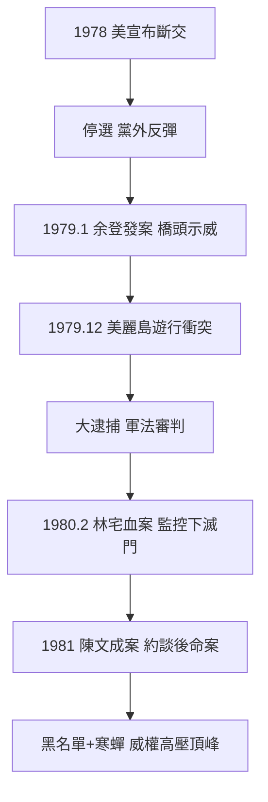

# 4.2 美麗島事件與政治謀殺陰影(1978-1981)

1978 年 12 月美國宣布與中華民國斷交（1979 元旦生效），蔣經國以「國難」為由停止中央民代增額選舉，黨外反彈。1979 年 8 月《美麗島》雜誌創刊串連黨外，12 月 10 日世界人權日高雄遊行演變為警民衝突（美麗島事件）。當局大逮捕：黃信介、施明德、姚嘉文、陳菊、呂秀蓮、林義雄、張俊宏等八人軍法審判（1980），施明德判無期，其餘 12–14 年；另有 30 餘人普通法院判刑。

## 余登發案、林宅血案、陳文成案：必須並陳的三案

- **余登發案（1979.1）**：高雄縣老縣長余登發父子以「知匪不報」被捕，黨外發動橋頭示威聲援——這是美麗島的前奏，模式與雷震案如出一轍；
- **林宅血案（1980.2.28）**：美麗島被告林義雄家中，母親與雙胞胎女兒被滅門殺害，長女重傷，兇宅竟在情治 24 小時監控之下。官方迄今未破案，促轉會與監察院調查指向情治涉案或縱放，至少是國家未盡保護之責；
- **陳文成案（1981.7）**：留美學者陳文成返台探親，被警總約談後陳屍台大校園。官方稱「畏罪自殺」，家屬與美方驗屍、促轉會調查均指向他殺疑雲，警總難脫干係。

三案加上海外黑名單（許信良、施明德胞弟等人有家歸不得），構成蔣經國任內人權紀錄最黑暗的一頁。官方把美麗島審判包裝為「公開審判、允許外媒旁聽」，卻不提軍法本質、刑求取供（陳菊、呂秀蓮等人自述）與其後的滅門、命案陰影。

## 史觀對照

- **官方敘事**：「美麗島是暴徒襲警，政府依法審判；林宅、陳文成與政府無關。」
- **黨外史料、解密檔案與研究證據**：美方解密電文（AIT、國務院人權報告）對審判公正性深表懷疑；林宅血案現場監控紀錄、陳文成案警總約談紀錄，經促轉會比對後認定國家涉案嫌疑重大，家屬至今未獲真相。學界（若林正丈、陳翠蓮）共識：此三案是威權體制「以非常手段補法律不足」的系統性產物，蔣經國作為體制頂端的知情與縱容責任無可迴避——即使無直接下令證據，一元體制下「不知情」本身即是失職。

## 因果鏈

斷交孤立 → 停選激化 → 黨外串連 → 美麗島鎮壓 → 軍法重判立威 → 林宅、陳文成命案寒蟬 → 海外黑名單斷後路 → 高壓換得 1980 年代初表面穩定 → 卻徹底透支政權道德正當性 → 為 1986 年組黨突圍積累能量。
