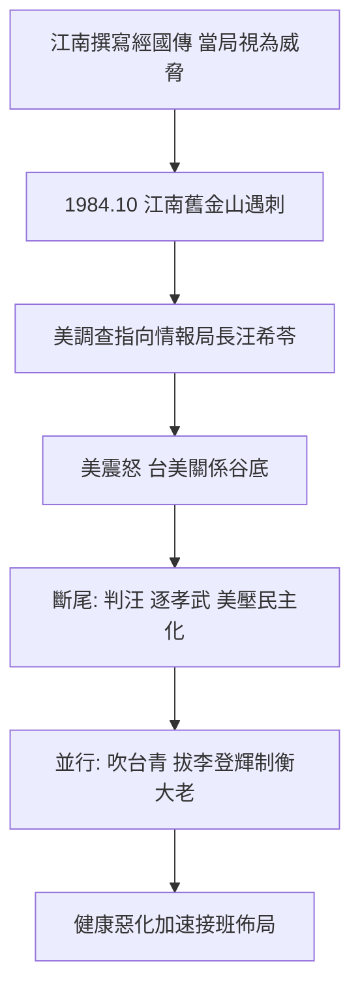

# 4.3 江南案與本土化佈局(1982-1986)

1984 年 10 月，旅美作家江南（劉宜良）在舊金山遭竹聯幫陳啟禮、吳敦等人槍殺。美方調查證實：竹聯受情報局長汪希苓指使，而汪自稱奉「上級」指示。美方震怒，將此案定性為台灣情治在美國本土的國家恐怖主義，台美關係降到谷底。1985 年汪希苓被判無期（後減刑假釋），蔣經國長子蔣孝武（時任情報系統要角）被外放新加坡，宋心濂等人調職——斷尾求生。

## 江南案的轉折意義

江南正撰寫《蔣經國傳》，揭露經國留蘇、贛南與情治黑歷史，當局視為心腹之患。江南案證明兩件事：一、蔣經國的情治機器到 1980 年代仍在境外執行暗殺；二、美國容忍的底線已到。此後美方加大對台灣人權與民主化的壓力，直接促成 1986–87 年的鬆動。江南案是蔣經國威權生涯最大的外交災難，也是解嚴的外部推手（見 5.1）。

## 吹台青與李登輝：接班的權力計算

與高壓並行的是本土化：1970 年代起「吹台青」（起用台籍青年菁英）、增額選舉吸納本省人，李登輝（1972 入閣、1981 台灣省主席、1984 副總統）是最關鍵的一步棋。官方說這是「經國遠見、族群融合」；更接近真相的解釋是權力計算：

- 外省老代表凋零、法統危機，本土化是續命術；
- 拔擢無派系的技術官僚李登輝，可制衡國民黨內大老與夫人派、太子派；
- 美方樂見本土面孔，有助緩解斷交後的正當性危機。

蔣經國晚年健康急遽惡化（糖尿病、視網膜病變，1985 年後半盲、洗腎傳聞不斷），加速了接班佈局。選李登輝，既是開放，也是保險——他賭李登輝能守住法統，歷史證明他賭錯了（或賭對了，視立場而定）。

## 因果鏈

情治暗殺慣性 → 江南案越境犯美 → 美方底線失守 → 外交災難轉為民主化外壓 → 同步以本土化（李登輝）續命法統、制衡黨內 → 健康惡化使接班提前 → 1986 年黨外組黨時，內外交迫的蔣經國已無鎮壓選項（見下一章）。
