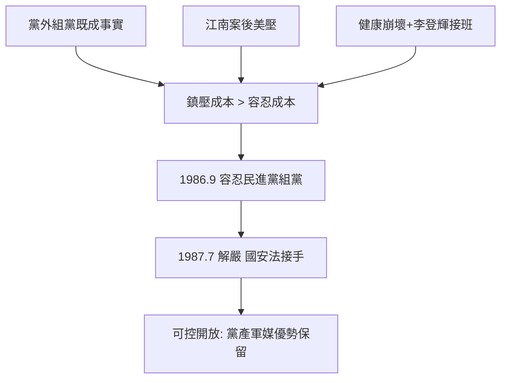

# 5.1 解嚴的多重驅動(1986-1987)

1986 年 9 月 28 日，黨外在圓山飯店組建民主進步黨；蔣經國未鎮壓。1987 年 7 月 15 日，宣布解除戒嚴（38 年戒嚴終結），開放報禁、黨禁鬆動在即。官方把這兩步說成「蔣公晚年開明、大智大仁」。

## 四重驅動，缺一不可

1. **黨外運動壓力**：美麗島大審後，黨外以「家屬參選」（許榮淑、方素敏、黃昭輝家屬）突圍，1983–86 年街頭與文宣不斷，組黨是水到渠成。鎮壓成本已高於容忍成本——抓了一個施明德，還有千千萬萬個。
2. **美國壓力**：江南案（1984）後，美方國會與行政部門聯手施壓，人權報告點名，軍售與貿易掛鉤民主化。再搞大逮捕，台美關係吃不消。
3. **接班佈局**：蔣經國健康崩壞（糖尿病併發症、失明在即），亟需在生前安排「可控的開放」——由自己解嚴，總比死後被街頭推翻好；李登輝的本土副手格局，也需要解嚴來正當化。
4. **權力計算**：解嚴不等於民主——動員戡亂仍在、國安法接手、刑法 100 條接手，國民黨黨產、軍隊、媒體優勢完整保留。以「自由化」換「本土政權延命」，是精算而非開明。

一言以蔽之：解嚴是內外交迫下的理性退場，不是聖人晚年頓悟。

## 史觀對照

- **官方敘事**：「經國先生順應潮流、高瞻遠矚，主動還政於民。」
- **檔案與研究證據**：蔣經國 1986 年與美方（丁大衛）、黨內（馬樹禮「老店新開」辯論）的談話紀錄顯示，他明確計算鎮壓後果與美國反應；黨外口述史（康寧祥、張俊宏）與美方解密檔案互相印證：沒有黨外組黨的既成事實與美國的紅線，解嚴不會發生。學界（朱雲漢、林佳龍、吳乃德）定調為「由上而下的分期付款式自由化」。

## 因果鏈

美麗島積累能量 → 江南案引來美壓 → 健康倒數 → 黨外組黨突襲 → 鎮壓選項被堵死 → 以可控解嚴換延命 → 威權鬆動但黨國資產完整移交 → 為 1990 年代民主化留下不公平起跑線。
