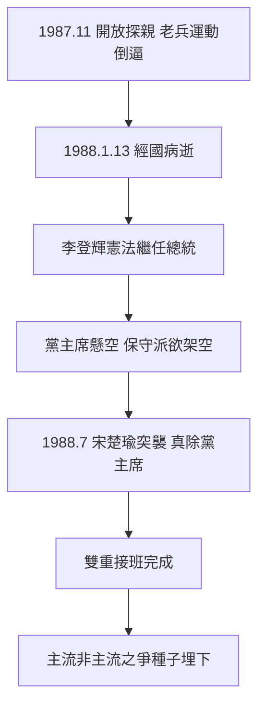

# 5.2 逝世與權力交接(1987-1988)

1988 年 1 月 13 日，蔣經國因糖尿病併發症病逝於台北榮總，享年 78 歲。遺囑稱「以基督徒身份」安息，棺覆黨旗，停靈、移靈，百萬民眾夾道——威權時代最後一場國家葬禮動員。

真正的戲在葬禮之後：副總統李登輝依憲繼任總統，但黨主席之位懸空。國民黨保守派（李煥、郝柏村、沈昌煥等）一度運作「代理主席」或集體領導，意圖架空李登輝；最終在宋楚瑜等人以眼淚與程序突襲下，李登輝於 1988 年 7 月全代會真除黨主席，完成「憲法 + 黨章」的雙重接班。這是蔣經國佈局的成功（本土副手順利繼位），也是其佈局的失敗（保守派根本不服李登輝，為 1990 年代主流非主流之爭、乃至國民黨分裂埋下引線）。

## 開放大陸探親：最後一筆

1987 年 11 月開放大陸探親（老兵返鄉），常被歸入「開明晚年」。實則驅動同樣多重：老兵「想家」運動（外省人返鄉自救會）壓力、兩岸情勢緩和、疏導榮民不滿。若無 1980 年代中期的自救運動，探親不會自動到來。

## 因果鏈

健康崩壞 → 提前佈局李登輝 → 病逝 → 憲法接班順利、黨內接班驚險 → 保守派不服 → 本土化列車出軌前控制（1990 年代分流）→ 探親開放同步疏導老兵 → 威權退場的善後工程在死前死後連續完成。
