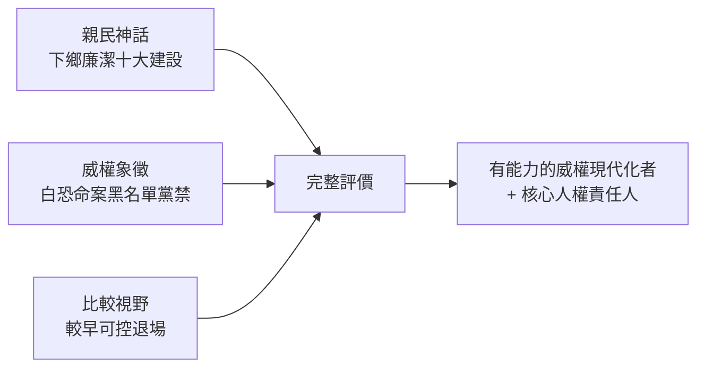

# 5.3 歷史評價之爭(1988迄今)

蔣經國死後，台灣對他的記憶分裂為至少三種形象，至今未癒合：

## 一、親民神話：下鄉、吃路邊攤、穿夾克

電視重播的畫面——經國下鄉與老農握手、吃小吃、走田埂——是威權晚期精心經營的媒體政治。不可否認他確實勤走基層、相對廉潔（相較孔宋與後來權貴），在 1970 年代 give 底層民眾真實的被看見感。但神話遮蔽了結構：親民秀與白恐、黑名單、報禁是同一個人的兩面。把「吃路邊攤」等同於「民主」，是範疇錯誤。

## 二、威權象徵：轉型正義視角

促轉會（2018–2022）、黨產會與人權館的調查，把蔣經國放回加害體制中定位：總政治部、救國團、雷震案、美麗島軍法審判、林宅血案與陳文成案的國家責任、江南案、海外黑名單——每一件都指向他。2022 年促轉會總結報告建議移除威權象徵（包括蔣經國銅像與紀念館），引發藍綠攻防。這不是「鬥爭」，而是遲到的對帳：經濟政績不能折抵人權債務，正如 $+100$ 不能抵銷 $-100$ 而聲稱等於零——兩本帳都要記。

## 三、複雜性：歷史脈絡中的實際作為

不妖魔化的另一面也要記：贛南的墾荒水利、上海的孤身犯險（雖敗）、台灣初期穩定幣制與土改延續、授權技術官僚、晚年未強力鎮壓組黨解嚴——在同時代威權者（朴正熙、全斗煥、馬可仕）光譜中，蔣經國屬於較早啟動可控退場者。這不是頌歌，而是比較威權研究的定位。若把他簡化為殺人魔，同樣違背史實，也無助於理解台灣為何能走出威權。

## 史觀對照（全書總結）

| 議題 | 官方/頌歌敘事 | 檔案與研究證據 |
|---|---|---|
| 白恐角色 | 僅辦政工教育 | 總政治部即清洗樞紐，孫立人案受益人 |
| 經濟奇蹟 | 個人英明 | 美援+土改+日治遺產+分工+技術官僚 |
| 美麗島 | 暴徒襲警依法審判 | 軍法+刑求，後續命案國家難脫責 |
| 江南案 | 下級擅自 | 情治鏈條直通頂層，美方定性國恐 |
| 解嚴 | 晚年開明 | 四重驅動的可控退場，黨國資產保留 |

本書立場：蔣經國是「有能力的威權現代化者」，也是「白色恐怖與一元體制的核心責任人」。兩句必須並陳，缺一即是 propaganda。

## 因果鏈（全書總因果）

蘇聯學極權術 → 贛南小試 → 上海大敗 → 來台掌政工情治 → 白恐立威、剷除替代者 → 十大建設收割結構紅利 → 美麗島高壓透支正當性 → 江南案觸怒美國 → 本土化續命 → 內外交迫下可控解嚴 → 病逝交棒 → 身後神話與究責之爭至今未休。下一個台灣民主故事，從李登輝與街頭開始——但起點的門，是經國在內外交迫下不得不開的那一扇。
