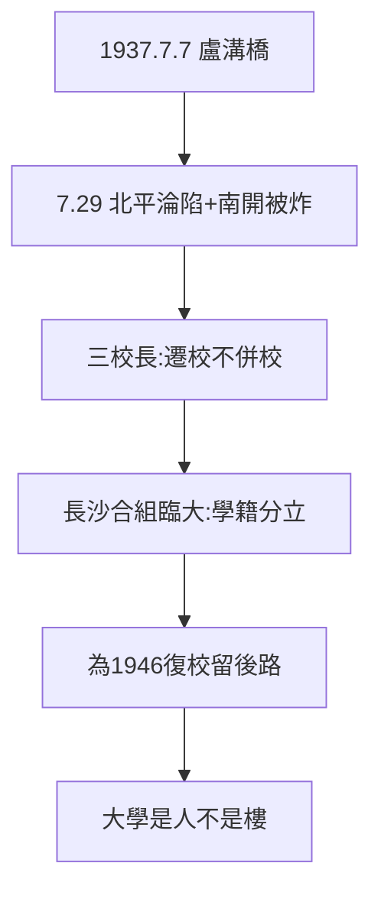

# 1.1 七七事變與三校南遷（1937）

## 1937 年 7 月 7 日：盧溝橋

日軍進攻宛平，全面抗戰爆發。7 月 29 日北平淪陷——南開校園毀於日軍轟炸（張伯苓聞訊說：「敵人炸毀南開之物質，南開之精神將因此更奮！」）；8 月清華圖書儀器被劫，校舍旋即被佔為兵營。

## 三校長的決斷

梅貽琦（清華）、蔣夢麟（北大）、張伯苓（南開）達成共識：**保存文化血脈，遷校不併校、人散心不散**。國民政府命三校在長沙合組臨時大學——不是三校合併，是三校合辦（學籍分立，為日後復校留後路，見 5.2）。

## 南遷的意義

大學南遷，中國歷史上第三次（前兩次：宋室南渡帶走太學？實則衣冠南渡）。但西南聯大是第一次「整建制遷移 + 合組」——**把大學連根拔起，種到兩千公里外**。敢這麼做，是因為相信：大學是人，不是樓（5.3 的主題，起點在此）。

**因果**：炮火（外因）+ 三校長的共識（內因）= 南遷。而「合辦不合併」的設計，決定了八年後的和平分手（5.2）。下一節，長沙。
