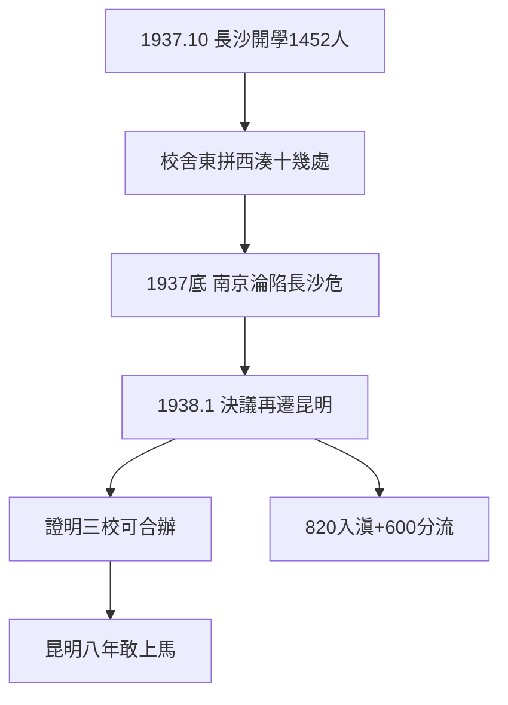

# 1.2 長沙臨時大學（1937–1938）

## 1937 年 10 月 25 日開學，11 月 1 日上課

國立長沙臨時大學開學：17 個學系，學生 1452 人（清華 631、北大 342、南開 147、新招 114、借讀 218），教職員 148 人。校舍東拼西湊：聖經學院、湘雅醫學院、湖南大學、重慶大學……——**一所大學，十幾處校舍**。

## 只存在 100 天的大學

1937 年底南京淪陷，武漢危急，日軍沿江而上，長沙危在旦夕。1938 年 1 月，臨大決議再遷昆明——存在不足半年的大學，成了中國教育史上最短命、也最重要的過渡：**它證明三校可以合辦**，昆明的八年（第 2 章）才敢上馬。

## 長沙的精神遺產

- 學生 1452 人中，820 人隨校入滇，600 餘人退學轉學或參軍（見 4.2）——第一次分流：讀書 vs 救國；
- 校慶日定為 11 月 1 日（臨大開課日）——聯大認長沙為正統起點，而非昆明；
- 「萬里長征，辭卻了五朝宮闕。暫駐足衡山湘水，又成離別。」（校歌）——長沙是第一個別離。

**因果**：七七南遷（1.1）→ 長沙試辦 → 證明可行 → 昆明長辦。100 天的臨大，是八年聯大的試用期——試用通過，轉正。下一節，入滇之路。
