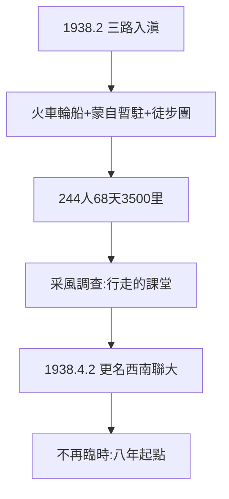

# 1.3 三路入滇（1938）

## 1938 年 2–4 月：三條路，一個昆明

臨大師生分三路入滇：女生、家屬乘火車輪船（經廣州、香港、海防、滇越鐵路）；文法學院暫駐蒙自；**湘黔滇旅行團**：244 名男生 + 11 位教師（聞一多、曾昭掄、吳征鎰等），徒步 3500 里（1600 公里），68 天橫穿湘黔滇——「遷徙本身即是教育」（常委會決議原話）。

## 旅行團：行走的課堂

- 沿途做調查、採集、教民歌（劉兆吉採 2000 餘首，後與聞一多整理成《西南采風錄》771 首，1946 出版）；
- 梅貽琦迎接時說：「險阻艱難，備嘗之矣；民之情偽，盡知之矣」——**中國的農村，在書本里讀不到，走得到**；
- 費孝通後來的《鄉土中國》（1947），田野方法的起點之一，就在這條路上。

## 1938 年 4 月 2 日：更名

教育部令：長沙臨大更名「國立西南聯合大學」。「不再稱臨時」——抗戰長期化的宣告，也是八年辦學的起點（第 2 章）。

**因果**：長沙試辦（1.2）→ 三路入滇 → 更名定局。徒步團把「遷徙」變成「教育」——聯大的第一課，不在教室，在路上。下一章，昆明開學。
