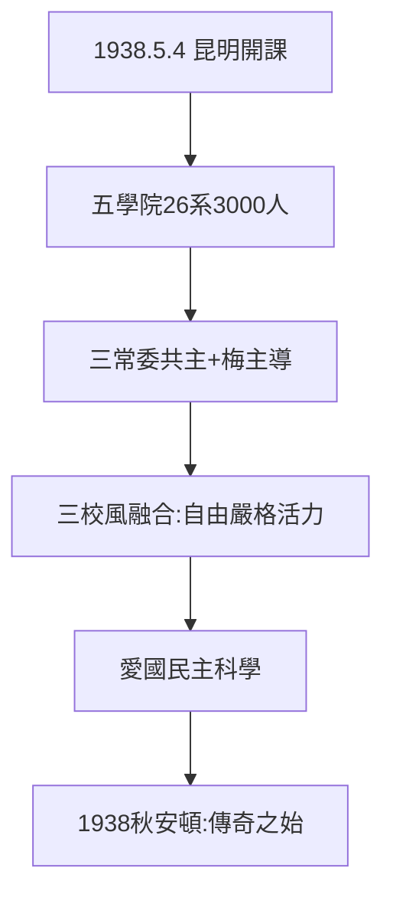

# 2.1 五月四日開課與五學院（1938）

## 1938 年 5 月 4 日：昆明開課

西南聯大在昆明開課（有意選五四紀念日）：文、理、法商、工、師範五學院，26 系，學生 3000 人——抗戰時期全國規模第一。校務由梅貽琦、蔣夢麟、張伯苓三常委共主，後蔣張駐重慶，梅貽琦長期主導（見 3.3）。

## 三校風的融合

- 北大：兼容並蓄（蔡元培遺風）；
- 清華：嚴謹求實（梅貽琦遺風）；
- 南開：活潑創新（張伯苓遺風）；
- 融合公式：北大的自由 + 清華的嚴格 + 南開的活力 = 聯大精神「愛國、民主、科學」（清華校史館總結）。

## 1938 年的昆明

文法學院先在蒙自（租中法學校），8 月借空軍校舍遷昆；全校散租會館、中學——**沒有校園的大學**。1938 年秋才算安頓（李鍾湘《西南聯大始末記》語）。安頓之日，即傳奇之始（第 3 章大師、第 4 章學生）。

**因果**：三路入滇（1.3）→ 五四開課 → 三風融合。1938 年 5 月 4 日，聯大從「遷徙」轉入「辦學」——而辦學的第一課，是校訓（下一節）。
