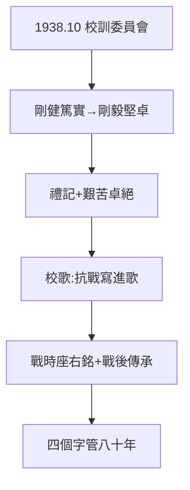

# 2.2 剛毅堅卓（1938）

## 1938 年 10 月：校訓誕生

聯大常委會聘馮友蘭、朱自清、羅常培、羅庸、聞一多為校歌校訓委員，原擬「剛健篤實」，後改定「**剛毅堅卓**」。出處：《禮記·儒行》「剛毅有如此者」+ 成語「艱苦卓絕」——剛毅（無私無畏）+ 堅卓（堅忍卓絕）。

## 校歌

羅庸作詞（聞一多篆額、羅庸書丹、馮友蘭撰文的紀念碑是另一件，見 5.2）：「千秋恥，終當雪；中興業，須人傑……多難殷憂新國運，動心忍性希前哲。待驅除仇寇，復神京，還燕碣。」——**把抗戰寫進校歌**，古今中外罕見。

## 校訓的效力

- 戰時：土坯房裡的座右銘（見 2.3）；
- 戰後：三校復校各自沿用精神（清華「自強不息厚德載物」+ 聯大記憶）；
- 當代：雲南師範大學（師範學院留昆，見 5.2）以剛毅堅卓為根本——**四個字，管用八十年**。

**因果**：五四開課（2.1）→ 十月校訓。先有學校，後有靈魂——而靈魂的試金石，是苦日子（下一節：跑警報）。
