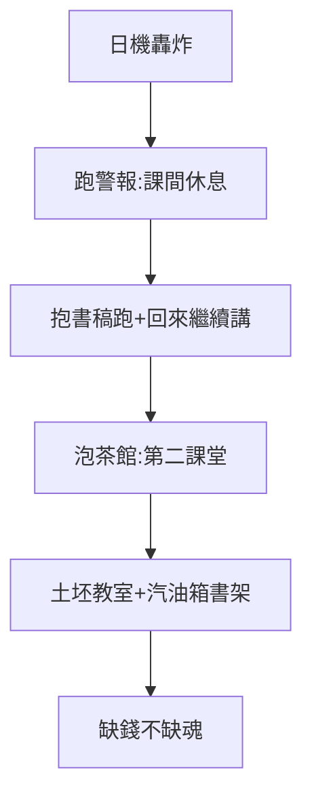

# 2.3 跑警報泡茶館（1938–1945）

## 跑警報：必修課

日機頻繁轟炸昆明，警報分預行、空襲、緊急三段。學生總結：初聞空襲跑，繼聞預行跑，最後「晴天也跑」（逃課的藉口）。教授們抱著書稿跑，跑回來繼續講——**警報是課間休息，讀書才是正課**。林語堂路過演講，驚嘆：「聯大師生物質上不得了，精神上了不得！」

## 泡茶館：第二課堂

文林街、鳳翥街茶館：喝茶、吃糕餅、打橋牌、寫論文——「泡」（久坐）字傳神。聞一多在茶館寫詩，學生在茶館備考，教授在茶館罵時政。**教室太擠，茶館擴容**——中國大學的「第三空間」，聯大發明。

## 土坯鐵皮教室

土牆、鐵皮頂，下雨時雨聲蓋過講課聲，師生「停課賞雨」苦中作樂；宿舍茅草頂，書架用廢汽油箱疊成。1940 年代初訪美的教授回憶：「美國同行問我缺什麼，我說缺錢；他們問還缺什麼，我說不缺了——**缺錢不缺魂**。」（大意如此，各種回憶版本）

**因果**：校訓（2.2）→ 苦日子的實踐。跑警報練膽，泡茶館練腦，土坯房練魂——而魂的內核，是人（下一章：大師）。
