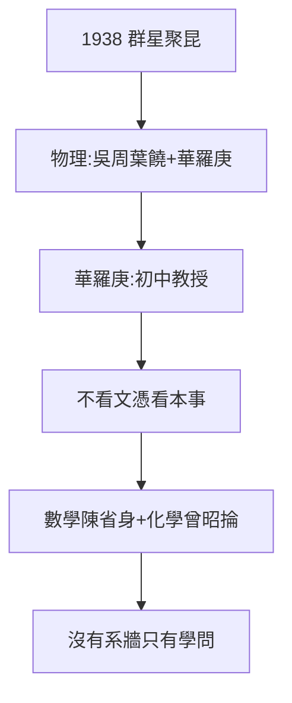

# 3.1 理學院群星（1938–1945）

## 物理：吳大猷周培源葉企孫饒毓泰

- **吳大猷**：量子力學課（楊振寧的老師，見《楊振寧傳》2.1）；
- **周培源**：流體力學，湍流理論；
- **葉企孫**：理學院院長，磁學，培養了王淦昌、錢三強、趙九章——「大師的大師」；
- **饒毓泰**：光學；
- **華羅庚**：1938 年聘為教授（初中學歷！眾人力薦），寫出《堆壘素數論》——**聯大不看文憑看本事**的象徵。

## 數學：陳省身

陳省身（南開→清華→漢堡博士）在聯大任教，微分幾何，後成「整體微分幾何之父」。1943 年赴美，1970 年代回國講學——**聯大數學的火種，燒到加州又燒回來**。

## 化學生物：曾昭掄吳征鎰

曾昭掄（旅行團教師，1.3）、吳征鎰（植物學，後成中科院院士）——文理兼通，是聯大師資的常態：**沒有系牆，只有學問**。

**因果**：三校合辦（1.1）→ 師資疊加 → 群星。而群星的光，照亮的是學生（第 4 章）——吳大猷的課堂裡，坐著楊振寧。下一節，文學院。
