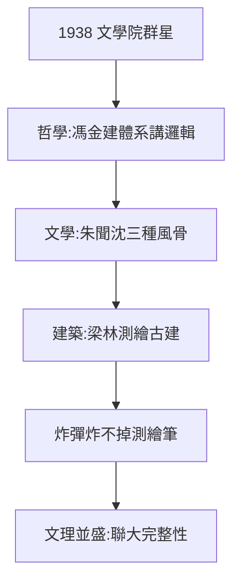

# 3.2 文學院群星（1938–1945）

## 哲學：馮友蘭金岳霖

- **馮友蘭**：文學院院長，寫《新理學》《新事論》（貞元六書之二）——戰火中建體系；
- **金岳霖**：邏輯（《論道》《知識論》），養雞（與雞同住？傳說他愛雞，雞死傷心）——**邏輯學家的天真**。

## 文學：朱自清聞一多沈從文

- **朱自清**：荷塘月色之後，寫《經典常談》，胃病拒吃美國麵粉（1948，氣節）；
- **聞一多**：從詩人到鬥士（1944 年後轉向政治，見 5.1）；
- **沈從文**：邊城之後，在聯大教寫作，穿長衫上課——**三個文人，三種風骨**。

## 建築：梁思成林徽因

1938 年聘梁思成、林徽因（营造学社南遷），測繪西南古建築——戰火中量房子，為後世留下《中國建築史》的田野。**炸彈炸不掉測繪筆**。

**因果**：理學院（3.1）+ 文學院（本節）= 完整大學。聯大不是技術學校，是全人教育——而全人的守護者，是校長（下一節）。
