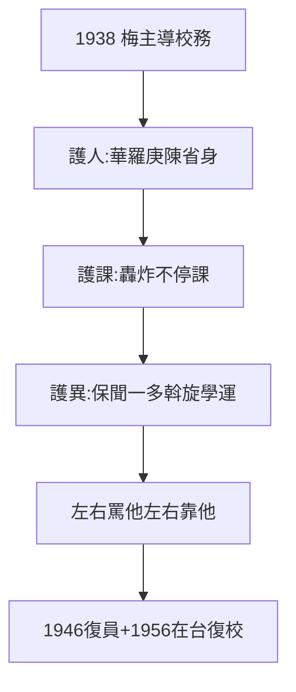

# 3.3 梅貽琦與教授治校（1938–1946）

## 梅貽琦：寡言的主席

梅貽琦（1889–1962，清華校長）話少，人稱「寡言君子」。名言：「**所謂大學者，非謂有大樓之謂也，有大師之謂也**」——1.1「大學是人不是樓」的官方版。八年聯大，他是實際掌舵者（蔣夢麟、張伯苓駐重慶）。

## 教授治校的三件事

1. **護人**：華羅庚（初中教授，3.1）、陳省身的聘任，他拍板——不看文憑；
2. **護課**：日機轟炸不停課（2.3），經費再缺不減教授薪（寧可自己墊）；
3. **護異**：聞一多轉向激進（5.1），他保護；學生運動（4.3），他斡旋——**左右都罵他，左右都靠他**。

## 「寡言」的力量

1946 年復員（5.2），三校分家，梅回北平清華園，1948 年赴美，1956 年在台復校清華（見竹科傳清華背景）。一生三建清華（北京、昆明、新竹）——**大學守夜人**。

**因果**：三常委（2.1）→ 梅主導 → 護人護課護異。聯大的靈魂不是校訓（2.2），是校長——而校長守護的，是學生（下一章）。
