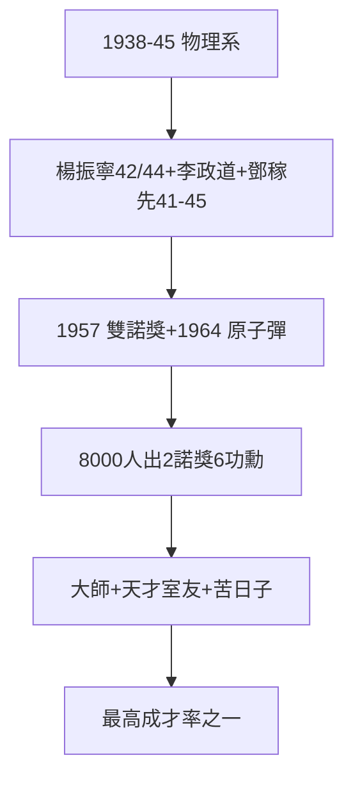

# 4.1 楊振寧李政道鄧稼先（1938–1945）

## 物理系的三個名字

- **楊振寧**：1938 年入聯大（見《楊振寧傳》2.1），1942 本科、1944 碩士（王竹溪），群論 + 統計力學——1957 諾獎；
- **李政道**：1940 年代初入聯大（浙大轉學），束星北、吳大猷的學生——1957 諾獎（與楊共得）；
- **鄧稼先**：1941 年入聯大物理系，1945 畢業，後赴美（普渡博士），回國造原子彈（1964）——跑警報的學生，在羅布泊簽字（清華校史館語）。

## 8000 人中的三個人

聯大九年約 8000 人就讀，畢業 2000 餘。出 2 諾獎 + 6 兩彈一星功勳（鄧稼先、朱光亞、郭永懷等）+ 近百院士——**人類教育史上最高的「成才率」之一**，在土坯房裡實現。

## 為什麼是聯大

- 老師（第 3 章）：吳大猷的量子課、王竹溪的統計課——大師面對面；
- 同學：楊振寧的室友是黃昆（半導體之父），鄧稼先的同學是楊振寧（發小，清華園）——**天才的室友還是天才**；
- 苦日子（2.3）：煤油燈下讀書，效率奇高——安逸出不了大師（至少聯大證明，苦難是最好的篩子）。

**因果**：大師（第 3 章）+ 苦日子（2.3）= 天才。而天才不只讀書，還從軍（下一節）。
