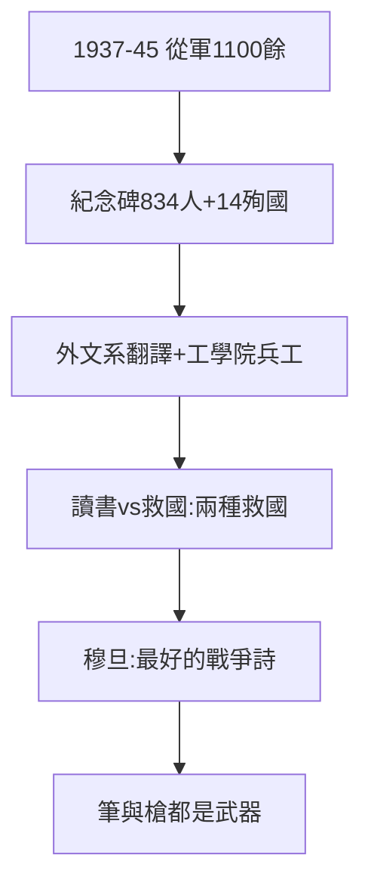

# 4.2 從軍報國（1937–1945）

## 834 人題名，14 人殉國

1946 年紀念碑（馮友蘭撰文、聞一多篆額、羅庸書丹）鐫刻從軍學生 834 人——實際 1100–1200 餘人（很多人沒留名），14 人殉國。外文系 400 餘人任軍事翻譯（駐印軍、駝峰航線）；工學院增設《兵工學》《要塞建築》——**課堂即戰場的預科**。

## 讀書 vs 救國：第一次分流

1938 年入滇時 600 餘人分流（1.2）：讀書的上路昆明，從軍的留下華中。1944 年預備兵役、一寸山河一寸血之際，又一批學生投筆——聯大從不阻止從軍（梅貽琦：讀書是長期的救國，從軍是即期的救國）。

## 穆旦：詩人從軍

穆旦（查良錚，聯大外文系）1942 年加入遠征軍，怒江野人山九死一生，寫下《森林之魅—祭胡康河上的白骨》——**中國最好的戰爭詩，出自聯大學生**。1977 年去世，詩名遲到三十年。

**因果**：長沙分流（1.2）→ 從軍傳統 → 紀念碑。而活著的學生，轉向另一種戰鬥：學運（下一節）。
