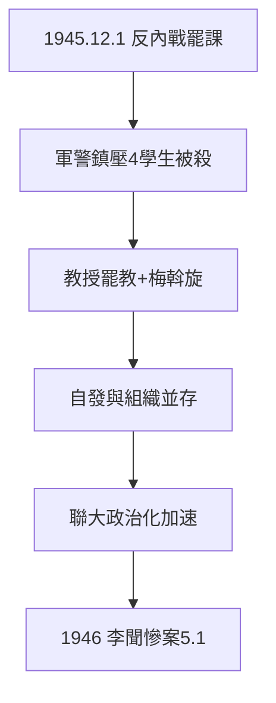

# 4.3 一二一運動（1945）

## 1945 年 12 月 1 日：反內戰

抗戰勝利，內戰陰雲起。聯大、雲大等校學生罷課反內戰，軍警鎮壓，4 名學生被殺（一二一慘案）。聯大教授（聞一多、朱自清等）罷教聲援——**師生一致，校方（梅貽琦）斡旋**（3.3 護異的實踐）。

## 一二一的性質（平衡敘述）

- 官方（中共）敘事：愛國民主運動，反蔣反內戰；
- 國民黨敘事：共產黨操縱學運；
- 學界：學生確有自發的反戰訴求，中共地下黨確有組織作用——**自發與組織並存**，非黑非白；
- 結果：加速聯大政治化，為 1946 年李聞慘案（5.1）鋪路。

## 從讀書到議政

1938 年的學生只想讀書（2.3 跑警報回來上課）；1945 年的學生要議政——戰爭結束，問題從「救國」變成「建國」。聯大的最後一年，是從書齋到街頭的一年。

**因果**：從軍的血（4.2）→ 學運的血。一二一是聯大從「讀書」到「議政」的轉折——而議政的代價，是教授的血（下一章）。
