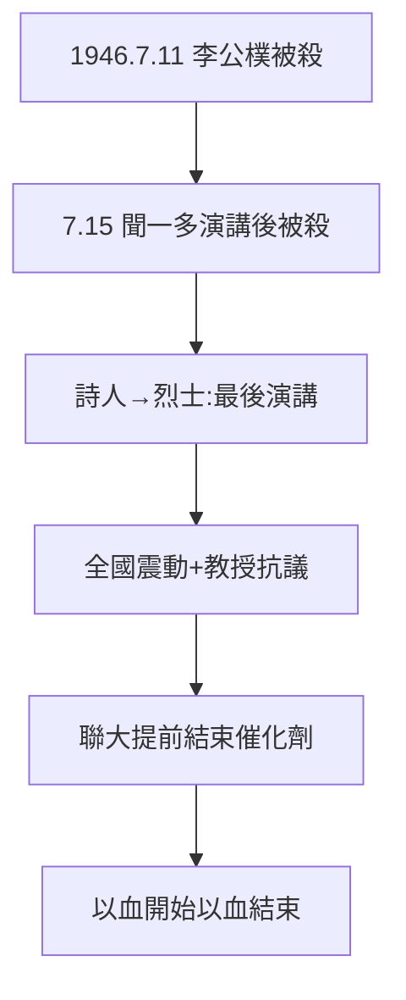

# 5.1 李聞慘案（1946）

## 1946 年 7 月 11 日、15 日

- 7 月 11 日：李公樸（民主同盟）在昆明被暗殺；
- 7 月 15 日：聞一多在記者會拍案怒斥（《最後一次演講》），散會後回家途中被槍殺——**詩人之死，聯大之殤**。

## 聞一多：從詩人到烈士

聞一多（1899–1946）早年新月派詩人（《死水》《紅燭》），1944 年後轉向政治（目睹腐敗 + 一二一刺激，4.3），加入民盟。最後演講：「我們要學李先生，踏著血跡前進！」——言出必踐，以身殉之。

## 慘案的歷史位置

- 兇手：特務（國民黨保密局系統，普遍認定）；
- 影響：全國震動，梅貽琦等教授抗議，聯大提前結束的催化劑（5.2）；
- 定位：國共內戰前夜的白色恐怖預演——聯大以血開始（七七，1.1），以血結束。

**因果**：一二一的政治化（4.3）→ 李聞之死。而死亡加速了落幕——下一節，復員。
