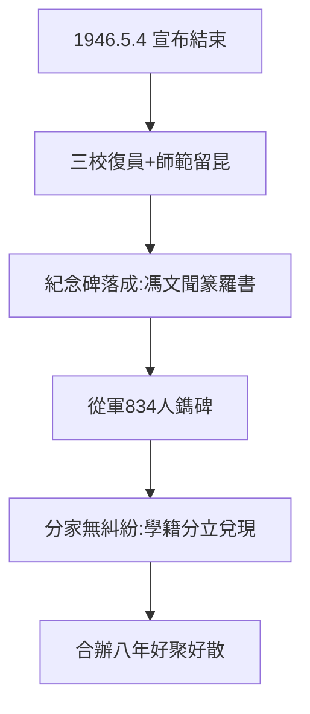

# 5.2 復員與紀念碑（1946）

## 1946 年 5 月 4 日：宣布結束

聯大宣布結束（開課八週年，2.1），三校復員北返：北大回北平、清華回清華園、南開回天津。師範學院留昆，改國立昆明師範學院（1984 年更名雲南師範大學）——**分手不分家：學籍分立（1.1）的設計，兌現了**。

## 紀念碑

5 月 4 日紀念碑落成（馮友蘭撰文、聞一多篆額——他兩個月後遇難，5.1、羅庸書丹），鐫刻從軍 834 人（4.2）。碑文末語：「……為學者，必有獨立之思想，自由之精神，……」（陳寅恪為王國維碑文語，此處化用？不——聯大碑文是馮友蘭原文；獨立自由語出陳寅恪，精神相通，後人常並提）。

## 復員的順利

三校分家無糾紛：圖書儀器按原校歸還，聯大學籍畢業生三校承認——**合辦八年，好聚好散**。1937 年的遠見（合辦不合併，1.1），1946 年收穫。

**因果**：1937 年的設計（1.1）→ 1946 年的兌現。李聞之血（5.1）是句號，紀念碑是驚嘆號——而真正的回聲，在身後（下一節）。
