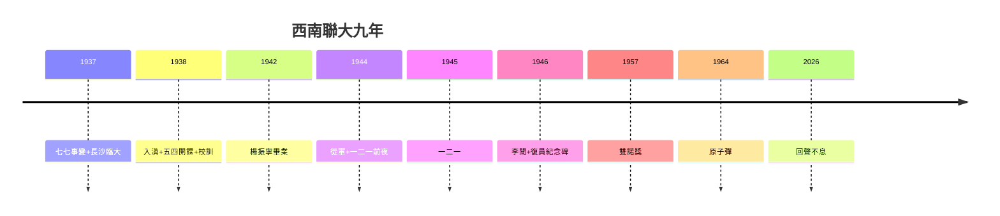

# 5.3 剛毅堅卓的回聲（1946–2026）

## 回聲一：兩彈一星

23 位功勳中 6 位聯大人（鄧稼先、朱光亞、郭永懷等）；1964 年原子彈爆炸，鄧稼先簽字——跑警報的學生（2.3），按下核按鈕。**土坯房裡的物理課，在羅布泊兌現**。

## 回聲二：諾貝爾獎

1957 年楊振寧、李政道（聯大物理系，4.1）共得物理獎——聯大是亞洲第一個「諾獎搖籃」（比卡文迪許晚，比全亞洲早）。2015 年屠呦呦（北大校友，間接傳承）再添一座。

## 回聲三：三校與新竹

- 北大、清華、南開復校，1952 年院系調整重組；
- 1956 年清華在台復校（新竹）——梅貽琦三建清華（3.3），竹科的鄰居（見《竹科傳》1.2 清交）；
- 雲南師範大學：師範學院留昆（5.2），剛毅堅卓的直系血脈。

## 回聲四：為什麼是聯大（史學總結）

- 天時：抗戰的共同敵人，壓制內鬥（一二一後才分裂，4.3）；
- 地利：昆明偏遠，少干擾（跑警報除外，2.3）；
- 人和：三校風融合（2.1）+ 梅貽琦（3.3）+ 大師（第 3 章）+ 好學生（第 4 章）；
- 公式：**共同敵人 + 好校長 + 大師 + 苦日子 = 奇蹟**——四者缺一不可，後人難複製（也無需複製，和平年代有和平的辦法）。

**因果閉環**：炮火（1.1）→ 南遷 → 長沙（1.2）→ 入滇（1.3）→ 開課（2.1）→ 校訓（2.2）→ 苦日子（2.3）→ 大師（第 3 章）→ 學生（第 4 章）→ 血與碑（5.1、5.2）→ 回聲（本節）。**九年，8000 人，2 諾獎，6 功勳，一個校訓**。聯大證明：大學是人不是樓（1.1、3.3）——而人，會把土坯房變成聖殿。聖殿拆了（1946），聖殿裡的人，建造了新中國的科學（1964）、台灣的科技（竹科，清交與梅貽琦的另一條線）——**一所死了八十年的大學，還在發畢業證**。
