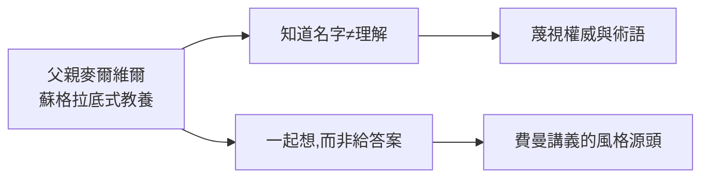

# 1.1 父親的教養：認識世界而非知道名詞

1918 年 5 月 11 日，理查·費曼（Richard Feynman）出生於紐約皇后區法洛克威（Far Rockaway）。父親麥爾維爾是服裝推銷員，母親露西爾是家庭主婦。費曼後來說，他一生最重要的老師不是大學教授，而是父親。

## 「看鳥」的寓言

父親帶小費曼去公園，指著鳥說：「你看那隻鳥在啄羽毛。你知道人們叫它什麼嗎？義大利人叫它一種名字，葡萄牙人叫另一種……但沒有人真正知道它為什麼啄羽毛——除了物理學家。」

這段話是費曼認識論的全部：**知道名字不等於理解事物**。他一生蔑視術語、頭銜與權威——諾貝爾獎得主的頭銜在他口中「還不如一個好笑話」。

## 浴缸裡的實驗

父親買來《大英百科全書》，父子在浴缸裡討論恐龍、星星與原子。麥爾維爾的原則：**永遠不要給出標準答案，要帶著孩子一起想**。這種蘇格拉底式的教養，後來變成費曼的教學風格——《費曼物理學講義》的每一頁都在「帶著讀者一起想」。

**因果**：法洛克威的浴缸與公園，製造了一個不怕權威、只服真理的頭腦。下一節，這個頭腦將在收音機裡找到第一個實驗場。
