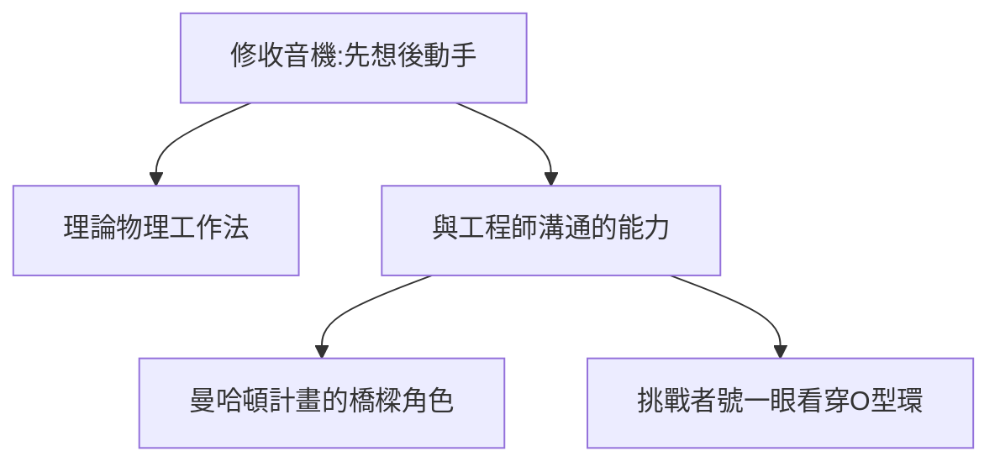

# 1.2 修收音機的少年工程師

## 「小魔術師」的名聲

1930 年代初，無線電剛普及，法洛克威的鄰居們的收音機壞了，都來找十幾歲的費曼。他收費低廉（有時免費），絕招是：**先想，再動手**——坐在壞機器前沉思半小時，動手五分鐘修好。

他的方法論日後寫進自傳：

1. 把現象想透，列出所有可能原因；
2. 按概率排序，一一排除；
3. 動手只驗證最後的假設。

這正是理論物理學家的工作方式——實驗室只是提前開張了。

## 偷聽來的知識

他混進成人無線電俱樂部，聽工程師們爭論電路；圖書館的書不夠看，就自學微積分——高中老師發現他在用自己發明的方法解題，氣得又好笑：「你這是重新發明了微積分！」

## 動手傳統的終身影響

- 曼哈頓計畫時，他能和工程師無障礙溝通（3.1）；
- 挑戰者號調查時，他一眼看穿 O 型環問題（5.3）；
- 他常說：「**我不信任我造不出來的東西**」——凡事要親手算一遍、想一遍。

**因果**：少年修理工訓練出的「動手直覺」，讓他終身在理論與實驗之間自由穿梭。這是費曼與純書齋型理論家的根本區別。
