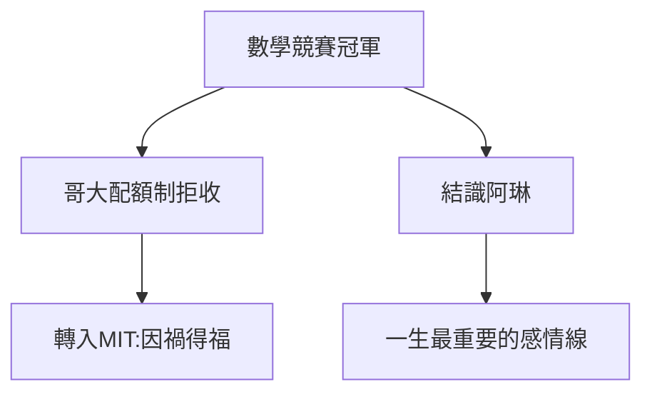

# 1.3 自我啟蒙與法洛克威高中歲月

## 全國數學競賽冠軍

高中時代的費曼已鋒芒畢露：紐約大學主辦的全國高中數學競賽，他以巨大分差奪冠。更傳奇的是解題風格——別人用標準方法，他用自創的怪招，常常更快。

## 配額制的牆

1935 年他申請大學時，撞上了常春藤對猶太學生的**配額制**：哥倫比亞大學因猶太配額滿了拒絕他。他轉而進入 MIT——這反而是幸運：MIT 的實用主義與動手文化，比哥大更適合他。

## 高中的兩個遺產

1. **阿琳·格林鮑姆（Arline Greenbaum）**：高中舞會上認識的女孩，後來成為他的第一任妻子（見 2.3、3.3）。她是唯一能讓天才低頭的人；
2. **自學的習慣**：高中圖書館沒有高等數學書，他就靠《高等微積分自學叢書》硬啃——「自己推導一遍才算懂」的習慣就此定型。

**因果**：配額制的歧視意外把他送進了最適合的學校；高中舞會則安排了他一生最痛的愛情。下一章，MIT 與普林斯頓將把數學冠軍變成物理學家。
