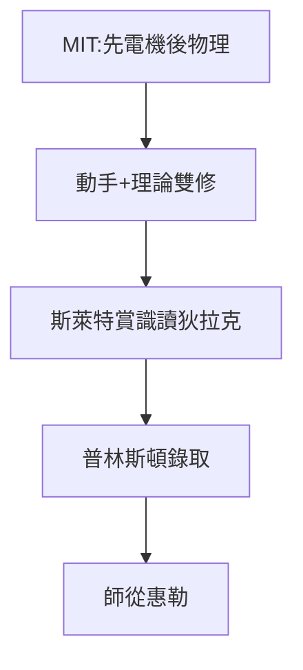

# 2.1 MIT 歲月：從電機到物理

## 實用主義的天堂

1935–1939 年，MIT 的氛圍是「做出來再說」。費曼先讀電機工程（延續收音機時代的老本行），大二轉物理系。轉系的原因很費曼：「電機系教我怎麼用公式，物理系教我公式從哪來。」

## 斯萊特的賞識

系主任斯萊特（John Slater）發現這個本科生在量子力學課上比研究生還強，給他開小灶讀狄拉克的《量子力學原理》。費曼的讀法是：**合上書，自己推一遍，推不出來再看**——狄拉克書裡的跳步，都被他補上了。

## 普林斯頓的邀請

1939 年本科畢業，研究生申請時 MIT 與普林斯頓都錄取他。普林斯頓的數學考試他拿了滿分（物理考試反而平平——他的物理是「野路子」，不按考綱出牌）。他選擇普林斯頓，因為那裡有**惠勒**（John Wheeler）。

**因果**：MIT 給了他工程師的底子，狄拉克給了他量子力學的骨架，而選擇惠勒則決定了他博士論文的方向——下一節，一老一少將幹出一件離經叛道的大事。
