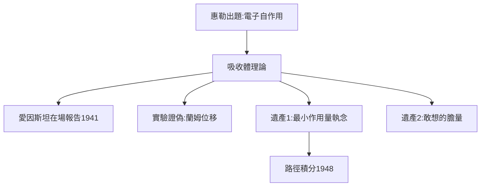

# 2.2 惠勒與「半前半後」的吸收體理論

## 忘年交

惠勒大費曼 7 歲，是愛因斯坦的同事、玻爾的信徒。他給費曼出的第一道題就不同凡響：「電子為什麼不作用於自身？」兩人發展出**吸收體理論**： электромагнетизм 不是場的傳播，而是發射體與未來吸收體之間的「半推遲、半超前」直接作用——時間對稱的電動力學。

## 愛因斯坦在場的報告

1941 年，費曼在普林斯頓做吸收體理論的報告，台下坐著愛因斯坦、泡利、馮·諾伊曼。23 歲的他緊張得發抖，惠勒在旁邊打氣。愛因斯坦聽完只說了一句：「這很困難，但或許是對的。」

## 失敗的偉大

吸收體理論最終被證明與實驗不符（它預言的蘭姆位移符號反了），但它留下了兩件遺產：

1. **最小作用量原理的執念**：費曼從此認定，量子力學應該能用「對所有路徑求和」來表述——這就是路徑積分的種子（見 4.2）；
2. **敢想的膽量**：在愛因斯坦面前講離經叛道的理論，這種膽量他用了一輩子。

**因果**：一個「錯誤」的博士課題，孵化了正確的方法論。費曼一生最重要的工具（路徑積分），正是在為錯誤理論尋找量子版本時誕生的——錯誤有時是最好的老師。
