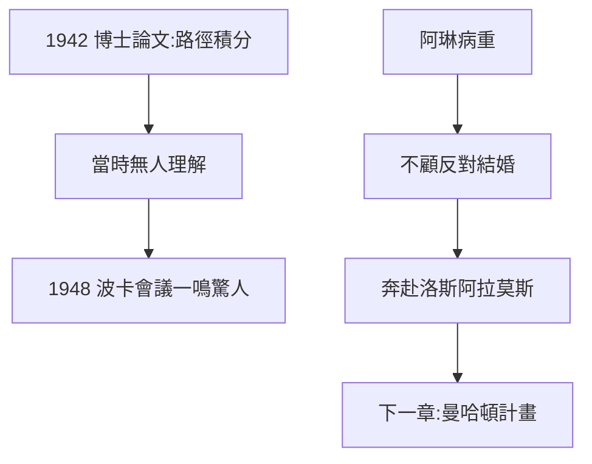

# 2.3 論文：量子力學的最小作用量原理，與阿琳的愛情

## 1942 年博士論文

費曼的博士論文題為《量子力學中的最小作用量原理》，正式提出**路徑積分表述**：粒子從 A 到 B 的機率幅，是對所有可能路徑的作用量相位求和：

$$K(B,A) = \int \mathcal{D}[x(t)]\, e^{iS[x]/\hbar}$$

評審委員會中有人看不懂，惠勒力排眾議讓他通過。當時幾乎無人意識到，這篇論文將在六年後改寫量子電動力學。

## 與阿琳的婚姻

阿琳患有結核病（當時的不治之症）。家人、朋友一致反對這門婚事，費曼不顧一切，1942 年 6 月與病中的阿琳結婚，婚後立即奔赴洛斯阿拉莫斯。婚禮上他吻新娘時還隔著口罩——醫生警告會傳染，他置之不理。

## 雙線並行的人生

1942 年的費曼，左手拿著人類歷史上最深奧的博士論文之一，右手牽著一個垂危的姑娘。這種「智識的極致與情感的極致並存」，是他一生的寫照。

**因果**：論文是「延遲引爆的炸彈」，婚姻是「明知結局的奔赴」。兩件事都發生在 1942 年，共同把 24 歲的費曼推向了戰爭與原子彈的漩渦。
