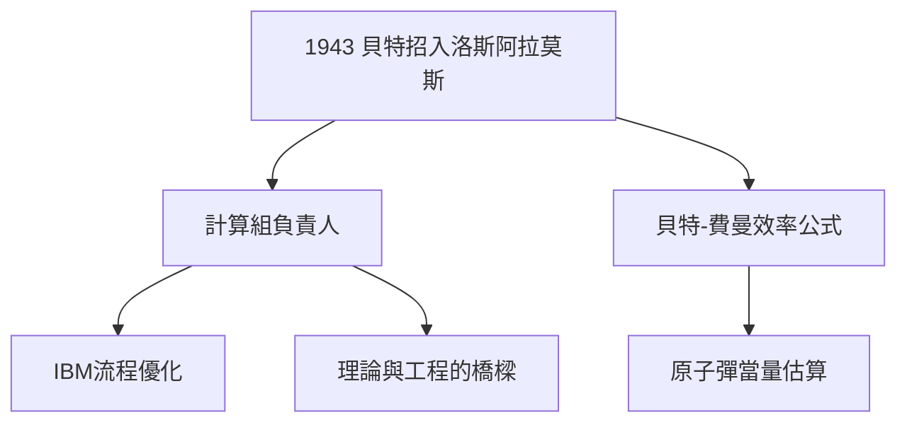

# 3.1 洛斯阿拉莫斯與漢斯·貝特

## 漢斯·貝特的慧眼

1943 年，貝特（Hans Bethe，康乃爾教授，曼哈頓計畫理論部主任）把 25 歲的費曼要到洛斯阿拉莫斯，任命他為**計算組負責人**——領導一群操作機械計算機的年輕人，計算內爆透鏡的流體力學。這是費曼第一次管人，管得極好：他改進了計算流程，把 IBM 打孔卡機的效率提高數倍。

## 貝特-費曼公式

兩人合作給出**裂變效率公式**（Bethe-Feynman formula），估算原子彈的當量與效率。貝特後來回憶：「費曼是我見過的最有原創性的人，他解決問題的方法永遠和別人不一樣。」

## 理論部的小太陽

- 他給工程師講量子力學，給理論家修計算機；
- 他發明了「費曼式」開會法：不許念稿，直接上黑板；
- 尼爾斯·玻爾來訪時，費曼是唯一敢當面說「你這個想法是錯的」的年輕人——玻爾反而最喜歡找他談話。

**因果**：收音機時代的動手能力（1.2）+ 惠勒時代的理論膽量（2.2）= 曼哈頓計畫中最獨特的跨界者。貝特的賞識，則為他戰後的去向（康乃爾）鋪好了路。
