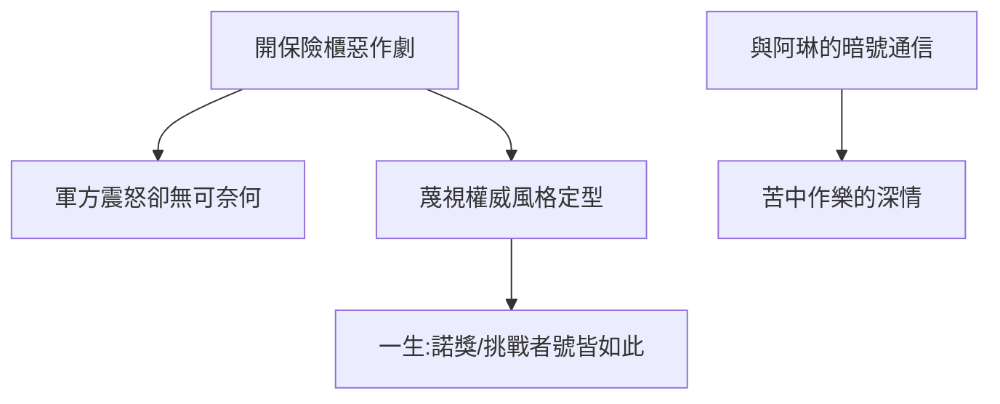

# 3.2 開鎖與開玩笑：聖塔菲的密碼學家

## 保險櫃大盜

洛斯阿拉莫斯的機密文件都鎖在保險櫃裡。費曼出於好玩，研究透了各種保險櫃鎖的弱點，能悄無聲息地打開同事的櫃子、放進小紙條「猜猜我是誰」。軍方震怒，他卻以此為樂——在他看來，**保密制度的愚蠢和物理定律的精妙一樣值得研究**。

## 審查信件的遊戲

他與阿琳的通信被軍方審查。兩人發明暗號：阿琳來信中的「密碼」其實是日常瑣事的代稱，審查官如臨大敵，費曼樂不可支。這場遊戲有苦澀的底色——阿琳在聖塔菲的療養院裡病情惡化，而他只能以這種方式保持聯繫。

## 「費曼風格」的定型

- 對權威的戲謔：連軍方將軍格羅夫斯都被他開過玩笑；
- 把一切變成謎題：鎖、密碼、官僚程序，在他眼裡都是待解的物理題；
- 底線：玩笑歸玩笑，計算原子彈數據時他分毫不差。

**因果**：洛斯阿拉莫斯的惡作劇不是不成熟，而是他認識論（1.1）的實踐——規則若不合理，就值得被戲弄。這種風格將在四十年後的挑戰者號聽證會上重演，而且那一次，全世界都在看。
