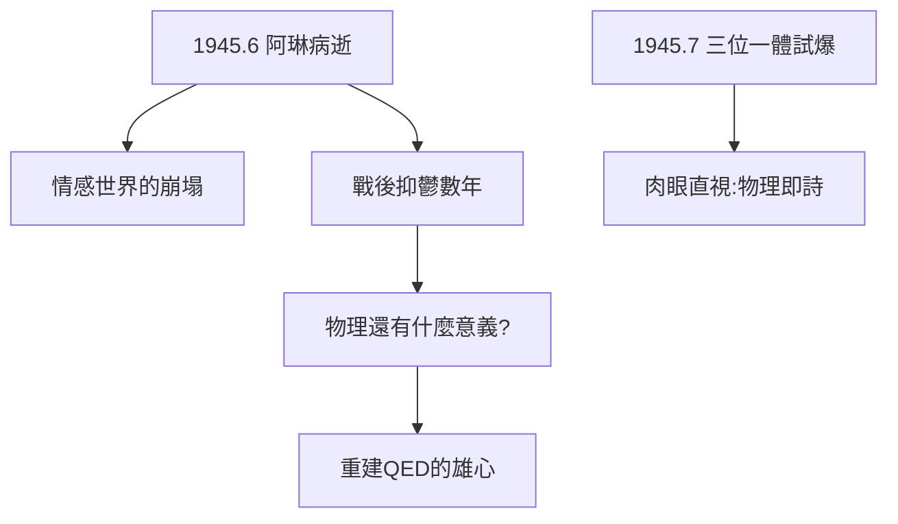

# 3.3 阿琳之死與原子彈試爆

## 1945 年 6 月 16 日

阿琳在聖塔菲療養院病逝，年僅 25 歲。費曼借車趕去，見到的是已經冰冷的遺體。他後來寫道：「我沒有哭，只是呆呆地看著時鐘——它還在走，時間對它毫無意義。」

多年後他給已故的阿琳寫了一封信（一直封存），結尾是：「**我愛你，我會一直愛你。理查。**」這封信在他去世後才被發現。

## 三位一體試爆

一個月後（1945 年 7 月 16 日），人類第一顆原子彈在阿拉莫戈多試爆。別人趴在地上戴墨鏡，費曼坐在卡車後面**直接用肉眼看**——他的理由是「紫外線傷眼，可見光沒事，擋風玻璃能擋紫外線」。物理學家的任性，在這一刻也是詩意的。

## 戰爭的賬單

- 物理上：他親手參與了人類最可怕的武器；
- 情感上：他失去了此生最愛的人；
- 戰後他陷入長達數年的抑鬱：「物理還有什麼意義？」——這個問題把他推向了康乃爾的低谷（見 4.1），也推向了重建物理學的雄心。

**因果**：失去阿琳讓他覺得舊物理已死——既然世界可以如此荒謬，那就重建一套更誠實的理論。下一章，路徑積分將從博士論文的故紙堆裡復活。
