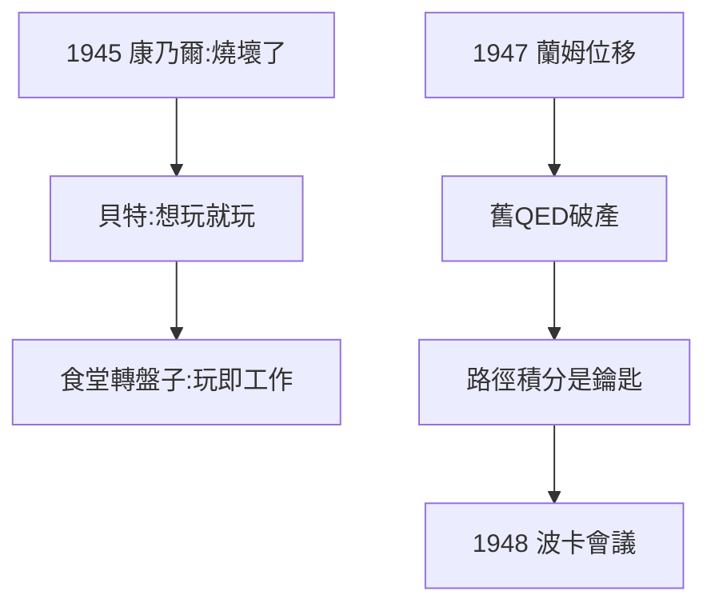

# 4.1 戰後低潮與貝特的挽留

## 「我燒壞了」

1945 年秋，費曼到康乃爾大學任教（貝特的安排）。但他提不起勁：上課敷衍、研究停滯，整天在酒吧和學生鬼混。他給朋友的信裡寫：「我覺得自己燒壞了（burned out），物理已經死了。」

## 貝特的耐心

貝特沒有放棄他，只是說：「你想幹什麼就幹什麼，不想幹就玩。」這種無條件的信任，反而讓費曼慢慢復活。他開始在康乃爾的食堂裡轉盤子玩——觀察盤子旋轉與晃動的頻率比，寫出一篇關於剛體轉動的論文。**玩，才是他工作的真正形態**。

## 轉機：蘭姆位移

1947 年，蘭姆（Willis Lamb）測出氫原子 2S-2P 能級的微小分裂（蘭姆位移），證明舊的量子電動力學有問題。貝特在火車上心算出粗略解釋，全場轟動。費曼意識到：**他的路徑積分（2.3）正是解決 QED 無窮大難題的鑰匙**。

**因果**：沒有貝特的「放養」，就沒有復活；沒有蘭姆位移的時代機遇，路徑積分可能永遠躺在博士論文裡。低谷與機遇相遇，就是下一節的爆發。
