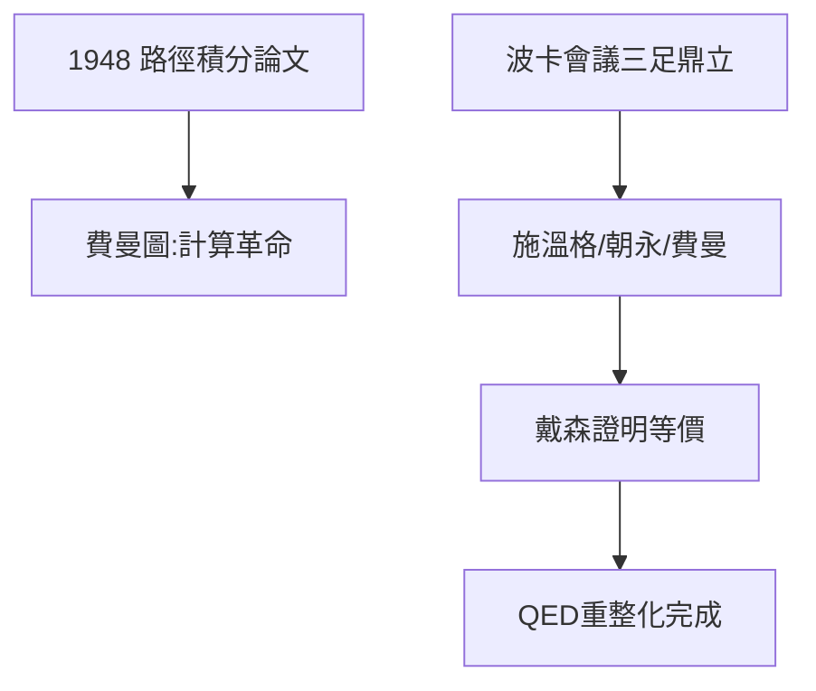

# 4.2 路徑積分：重新發明量子力學

## 1948：兩篇論文

1948 年，費曼在《現代物理評論》發表《量子力學的時空觀點》，系統提出路徑積分；隨後發明**費曼圖**：用小小的線條與頂點表示粒子的產生、湮滅與相互作用，把恐怖的微擾計算變成「連連看」。

費曼圖的規則簡單到不可思議：

- 每條線 = 傳播子（propagator）；
- 每個頂點 = 相互作用，貢獻耦合常數；
- 把所有圖加起來 = 散射振幅。

## 1948 波卡會議：三足鼎立

1948 年 3–4 月波卡（Pocono）會議，QED 重建的三位主角同台：

| 人物 | 方法 | 風格 |
|---|---|---|
| 施溫格 | 算符形式、協變微擾論 | 嚴密、艱深 |
| 朝永振一郎 | 超多時理論 | 獨立、日本戰後重建 |
| 費曼 | 路徑積分 + 費曼圖 | 直觀、好算 |

起初沒人聽得懂費曼（玻爾等人質疑連連），但年輕一代迅速倒戈——費曼圖太好用了。戴森（Freeman Dyson）隨後證明三種形式等價，QED 就此統一。

**因果**：博士論文的種子（2.3）經過吸收體理論的澆灌（2.2）、戰爭的休眠（第 3 章），終於在 1948 年開花。費曼圖至今仍是每個粒子物理學生的第一課。
