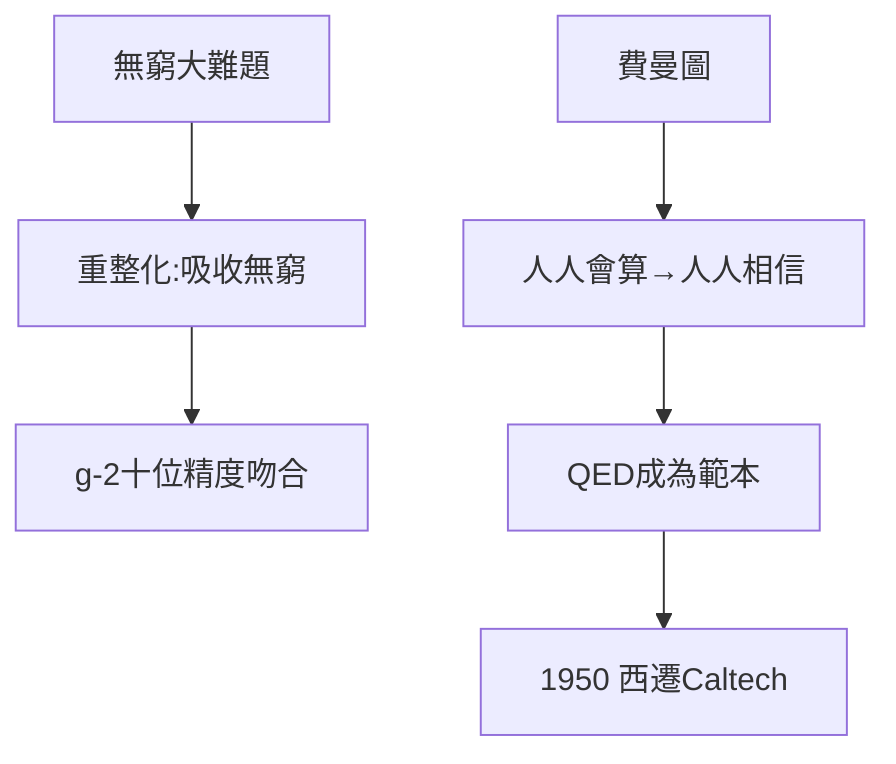

# 4.3 1948 波科諾會議與 QED 重整化

## 重整化的勝利

QED 的核心難題是**無窮大**：電子自能、真空極化的圈圖計算都發散。重整化的思想是：把無窮大量吸收進電子質量與電荷的「重新定義」中，剩下的有限部分與實驗精確吻合——蘭姆位移、電子反常磁矩 $g-2$ 的計算值與實驗值符合到小數點後十位，人類歷史上最精確的理論預言。

## 費曼的角色

施溫格與朝永提供了嚴格的協變形式，費曼提供了**算得動的工具**。沒有費曼圖，高階圈圖計算幾乎不可能完成。可以說：施溫格證明了 QED 是對的，費曼讓全世界相信它是對的——因為人人都能算了。

## 1950：西遷加州理工

1949–50 年，費曼訪問巴西（學會打邦戈鼓、學葡萄牙語），隨後接受加州理工（Caltech）的聘請。康乃爾的冬天太冷，而加州有陽光、有脫衣舞俱樂部（他愛去那裡思考物理，聲稱「那裡沒人打擾」）、有全新的開始。

**因果**：QED 的勝利讓費曼從「怪才」變成「大師」，也給了他去加州的資本。下一章，是他在加州三十八年的豐收——以及那場震驚世界的聽證會。
