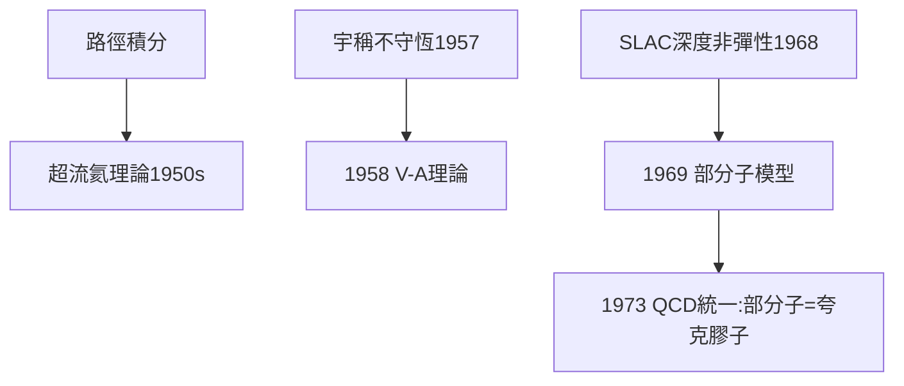

# 5.1 超流氦與部分子模型

## 超流：用路徑積分看液氦

1950 年代，費曼把路徑積分用到液氦超流問題：提出超流的本質是**大量氦原子進入同一量子態的宏觀量子現象**，用「路徑纏繞」圖像解釋了 λ 相變與第二聲。這項工作展示了路徑積分不限於粒子物理——它是整個量子多體的通用語言。

## 弱相互作用：V-A 理論

1958 年，費曼與蓋爾曼（Murray Gell-Mann）提出弱相互作用的 **V-A 理論**（矢量減軸矢量），解釋了宇稱不守恆（楊-李 1956）的具體形式。諷刺的是，蓋爾曼因此與費曼的關係長期緊張——兩個天才在同一走廊裡互相較勁了三十年。

## 部分子模型（1969）

為解釋斯坦福直線加速器（SLAC）的深度非彈性散射實驗，費曼提出質子內部有**部分子（parton）**——點狀組分在高能下表現為自由粒子。這與蓋爾曼的夸克模型殊途同歸，1970 年代 QCD 確立後統一：部分子就是夸克與膠子。

**因果**：從 QED 到超流到弱作用到強子結構，費曼的每一跳都踩在實驗的鼓點上。這種「跟著實驗走」的品味，正是收音機少年（1.2）的成年版。
