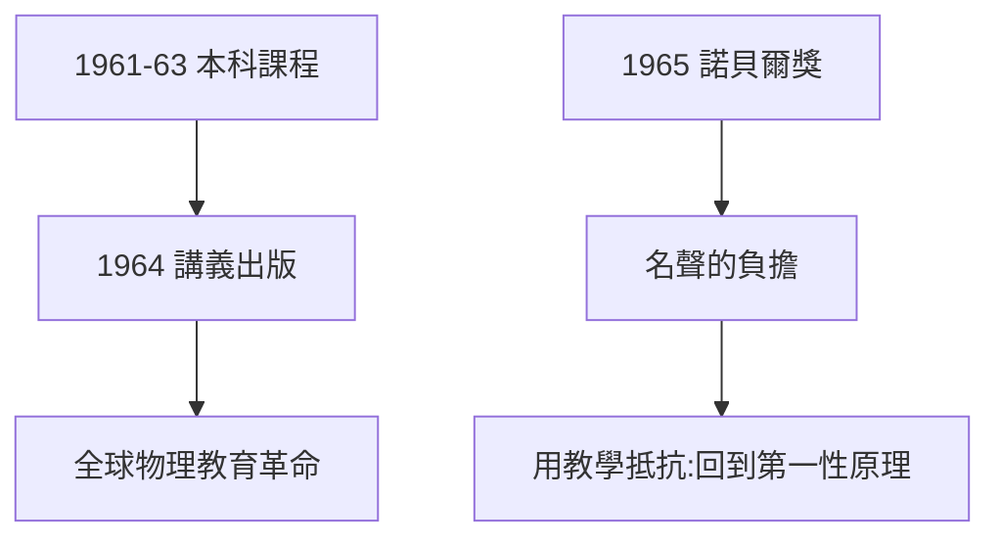

# 5.2 1965 諾貝爾獎與《費曼物理學講義》

## 斯德哥爾摩：三人分享

1965 年，費曼與施溫格、朝永振一郎同獲諾貝爾物理學獎，表彰 QED。他在自傳裡抱怨領獎的繁文縟節，但演講本身極精彩——用大白話講清了重整化。

## 《費曼物理學講義》（1964）

1961–63 年，他給 Caltech 本科生開大一物理課，萊頓與桑茲整理成三卷本《費曼物理學講義》。它的革命性在於：

1. **從第一性原理講起**：第一章就講原子假說，而不是先講測量單位；
2. **處處是「一起想」**：父親的蘇格拉底風格（1.1）的完整再現；
3. **六十年不衰**：至今仍是全球物理學生的案頭書，加州理工新生人手一套。

## 教學即研究

費曼的名言：「**我教書，是因為教不會就說明我沒懂。**」講義中許多章節（如棘輪與棘爪、最小作用量）是他現想現講的原創研究——課堂成了他的第二個實驗室。

**因果**：諾獎是過去的加冕，講義是未來的播種。費曼深知獎章會過時、書不會——他把最多的心血留給了大一新生，而不是同行評審。
