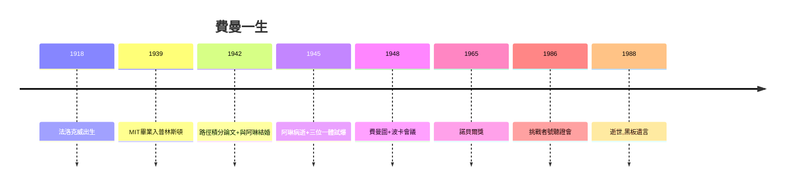

# 5.3 挑戰者號調查與永恆的遺產

## 1986：一杯冰水

挑戰者號太空梭爆炸後，費曼被任命為事故調查委員會成員。他買了 O 型環材料的樣品，在全國直播的聽證會上，把它夾進一杯冰水，再用鉗子夾出來——樣品失去彈性，脆如餅乾。全場譁然：**低溫下密封圈失效**，就是事故原因。

這一幕是費曼一生的縮影：不信任報告、不信任權威，只信任**親手做的實驗**（1.2 的收音機少年回來了）。

## 附錄：被壓下的真相

他堅持在官方報告後附上個人附錄，直言 NASA 管理層「把不確定性當作確定性販賣」。委員會主席想刪，他以辭職相脅，最終附錄保留。

## 1988：最後的黑板

1988 年 2 月 15 日，費曼因癌症去世，享年 69 歲。Caltech 辦公室黑板上留著他最後的字：「**我所不能創造的，我就不理解。**」（What I cannot create, I do not understand.）

遺產清單：路徑積分、費曼圖、V-A、部分子、講義三卷、量子計算的先聲（1982 年演講提出用量子系統模擬量子系統）、納米技術的先聲（1959 年演講《底部還有很大空間》）。

**因果閉環**：從父親的「知道名字不等於理解」（1.1），到黑板上的「不能創造就不理解」——費曼用一生把父親的教養變成了科學哲學。冰水裡的 O 型環，是他給世界的最後一課。
