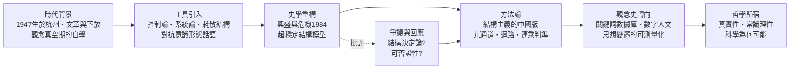

# 金觀濤

> Jin Guantao and the Science of Structure
> ——一位用控制論重寫中國史的哲學家：傳記、方法論、超穩定結構與真實性哲學

## 總序：思想探案——解剖一位「結構工程師」

在探案庫的其他書裡，金觀濤總是以證人身份出場：在《工業革命為何出現在歐洲》中，他的「理論—實驗—技術」九通道迴路被用作偵查放大鏡；在《國家為何衰敗》與《國家如何才能在數目字上管理》中，他的治理迴路成為解剖骨架。但證人自己是誰？他為何要提出這些結構？這本書要偵辦的案子是：**一個1940年代生於杭州、文革中被下放到鄉村的年輕人，如何在普遍迷信意識形態的年代，成為用控制論、系統論解剖中國歷史的思想家？**這不僅是一部傳記，更是一次方法論的解剖——金觀濤一生的學術事業，本身就是一條「理論—實驗—技術」迴路的社會科學版。

### 本書的敘事主軸

金觀濤的一生可以拆成四段互相咬合的學術事業，每一段都對應本書的一章：

1. **傳記與時代**：從杭州到北京大學化學系，從文革下放到《走向未來》叢書主編——他的思想是在「觀念的真空期」裡自力重建的。這段經歷解釋了為何他的方法論如此強調「用自然科學的工具對抗意識形態的話語」。
2. **控制論的引進**：他把 Wiener 的回饋概念、Prigogine 的耗散結構、貝塔朗菲的系統論，翻譯成中文社會科學的分析語言——不是套用，而是**把自然科學的「結構思維」本土化**。
3. **超穩定結構史學**：與劉青峰合著《興盛與危機》（1984）與《開放中的變遷》（1994），提出中國兩千年王朝政治的「超穩定系統」模型——宗法一體化結構、意識形態與政治的合一、崩潰—重建的振盪。這是社會科學史上第一個用控制論寫成的中國通史假說。
4. **方法論與真實性哲學**：晚年的金觀濤轉向觀念史（關鍵詞的數據庫計量）與哲學（「真實性」問題），回到他所說「科學必須回答自己為何可能」的根本問題。

### 全書結構圖

### 目錄（Wiki 書篇目）

* 第1章 傳記：從杭州到北京——一位化學系學生的思想自力重建
* 第2章 控制論的引進：把回饋、穩態、自組織變成中文的社會科學語言
* 第3章 超穩定結構：《興盛與危機》與中國史的系統論假說
* 第4章 方法論：結構主義的中國版——迴路、九通道與連乘判準
* 第5章 觀念史與數位人文：從《觀念史研究》到關鍵詞數據庫
* 第6章 真實性哲學：科學為何可能——金觀濤的晚年歸宿
* 第7章 爭議與影響：超穩定結構被接受、批評與內化的歷史

### 本書與探案庫其他書的關係

- [工業革命為何出現在歐洲](../../歷史探案/書籍/工業革命為何出現在歐洲/README.md)：金觀濤循環結構被用作分析框架的第一本書，本書解釋這個框架從何而來。
- [國家為何衰敗](../../歷史探案/書籍/國家為何衰敗/README.md)：以金觀濤式治理迴路為骨架的衰敗病理學。
- [國家如何才能在數目字上管理](../../歷史探案/書籍/國家如何才能在數目字上管理/README.md)：金觀濤四環閉合模型的國家能力版。
- [美國為何崛起](../../歷史探案/書籍/美國為何崛起/README.md)、[中國為何在鄧小平之後崛起](../../歷史探案/書籍/中國為何在鄧小平之後崛起/README.md)：迴路模型的擴散與再閉合案例。
- [科技發展史](../../歷史探案/科技史/科技發展史/README.md)：金觀濤循環結構的方法論總庫。
- [未來史](../../歷史探案/世界史/未來史/a_b_c/README.md)：迴路結構向未來推演的延伸。

### 方法論聲明

本書以「思想探案」方式寫作：先立事實（生平、著作、時代脈絡），再拆方法（結構、迴路、連乘），後驗證（批評、反例、可否證性）。所有對金觀濤理論的轉述均標註著作與年份；所有批評均以探案庫相應章節為證據鏈。**本書的立場是：金觀濤的偉大不在於他給出了「正確」的歷史模型，而在於他示範了一種社會科學的方法——用結構的語言取代意識形態的語言，用可否證的迴路取代不可否證的斷言。**
