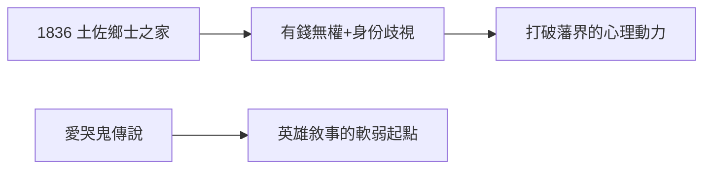

# 1.1 出生（1836）

1836 年 1 月 3 日（天保 6 年 11 月 15 日），阪本龍馬出生於土佐藩（今高知）城下町。阪本家是鄉士（下級武士）兼商人——釀酒、販衣，有錢無權。乳名「直陰」，後改「直柔」，「龍馬」是脫藩後用的名字。

## 鄉士的尷尬

土佐藩等級森嚴：上士（城下武士）壟斷官職，鄉士（農村武士）備受歧視。龍馬自幼體會「身份的天花板」——這種不甘，後來變成他打破一切藩界（薩長同盟、海援隊）的心理動力。

## 愛哭鬼的傳說

傳說幼年龍馬愛哭、尿床，被姐姐乙女嘲笑，後發奮學劍。傳說的真偽不重要，重要的是敘事功能：**英雄必須有一個軟弱的起點**（見 5.3 神話建構）。

**因果**：鄉士的身份是龍馬一生的起點與燃料——因為被藩界壓迫，所以要打破藩界；因為是下級武士，所以能聯合下級武士（薩長的下級武士正是維新主力）。下一節，劍術。
