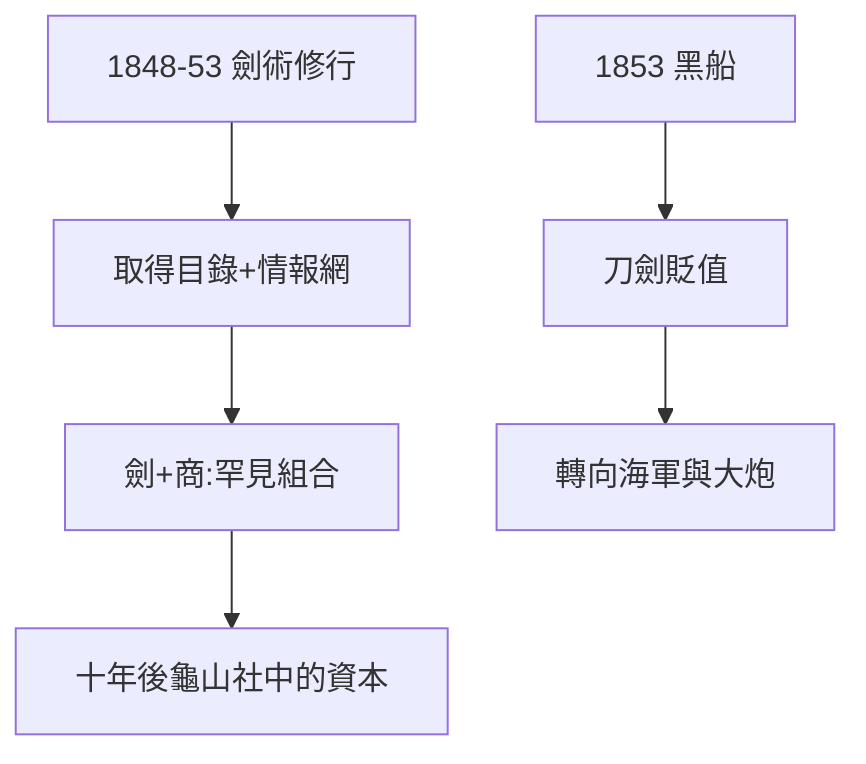

# 1.2 劍術修行（1848–1853）

## 北辰一刀流

1848 年起，龍馬修習小栗流，後入江戶千葉道場（北辰一刀流），取得目錄（免許）。劍術給他的不只是武藝：道場是各藩青年的情報交換站——他在這裡第一次聽到「攘夷」「開國」的爭論。

## 劍與算盤

阪本家經商，龍馬自幼看賬本。劍術（武）+ 商才（商）的組合，在當時武士中極罕見——十年後，這個組合成為龜山社中（3.1）的全部資本：能談判，也能算賬。

## 1853：兩件事

- 春：取得劍術目錄，意氣風發；
- 夏：黑船來航（見 1.3），世界觀崩塌。

劍術的頂峰，恰逢劍術的貶值——大炮面前，刀再快也沒用。這個領悟把他推向海軍（2.2）。

**因果**：劍術給了他自信與人脈，黑船拿走了劍術的意義。舊武器的頂峰正是新武器的起點——下一節，黑船。
