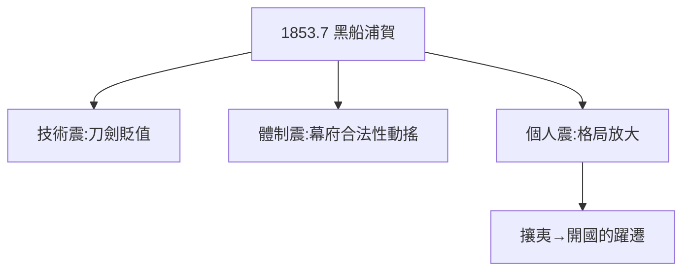

# 1.3 黑船來航（1853）

## 1853 年 7 月 8 日：浦賀

美國培理（佩里）率四艘黑船駛入浦賀，炮口對準江戶。龍馬時在江戶，親眼見到幕府的慌亂：連夜築炮台、老中失眠、謠言滿天。他在給姐姐的信中寫道：「日本要完了。」

## 世界觀的三級震

1. **技術震**：蒸汽船、大炮——刀劍（1.2）一夜貶值；
2. **體制震**：鎖國二百年，一觸即潰——幕府的合法性動搖；
3. **個人震**：土佐鄉士的煩惱（1.1）與國家危機相比，微不足道——格局被迫放大。

## 從攘夷到開國

最初龍馬也是攘夷派（買了外國手槍準備打夷）。但接觸勝海舟（2.2）後轉向開國論：**與其攘夷，不如學夷**——這個轉向是他一生最重要的思想躍遷。

**因果**：黑船是龍馬人生的分水嶺：此前是土佐青年的煩惱，此後是日本青年的煩惱。劍術的貶值（1.2）+ 身份的不甘（1.1）+ 國家的危機 = 脫藩的全部動機。下一章，江戶遊學。
