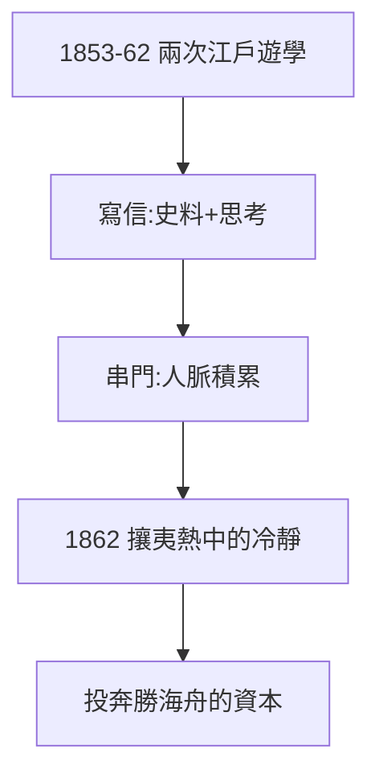

# 2.1 江戶遊學（1853–1861）

## 兩次江戶行

- 1853–54：劍術修行兼海岸警備（黑船再來時，他在品川守炮台）；
- 1861–62：再次遊學，接觸各藩志士，攘夷熱高漲。

## 情報商的養成

遊學期間，龍馬養成兩個習慣：

1. **寫信**：給姐姐乙女的長信，記錄時局、人物、物價——今天研究幕末的一手史料；
2. **串門**：各藩道場、酒館，見人就聊——人脈的原始積累。

## 攘夷熱中的冷靜

1862 年，長州藩下關炮擊外國船，舉國亢奮。龍馬卻在思考：炮打得贏嗎？打贏了然後呢？——這種「熱中帶冷」的氣質，讓他在兩年後能說服勝海舟（2.2）收他為徒。

**因果**：黑船的震撼（1.3）需要消化，遊學的八年就是消化期。信件訓練了他的筆（後來的船中八策），串門訓練了他的嘴（後來的薩長斡旋）。下一節，決定性的相遇。
