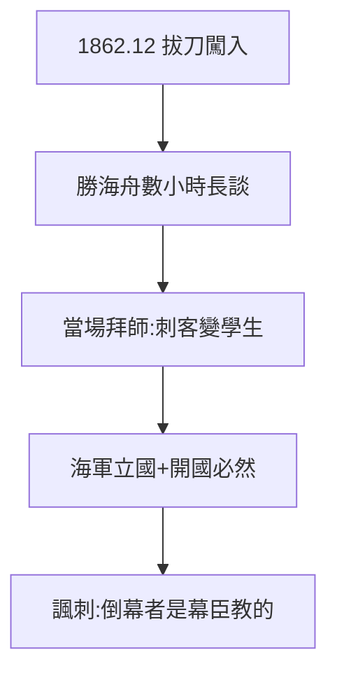

# 2.2 勝海舟門下（1862–1863）

## 1862 年 12 月：拔刀闖入

龍馬懷著「殺開國派」的攘夷激情，拔刀闖入幕臣勝海舟宅邸。勝海舟不慌不忙，談起世界海軍、國際形勢，滔滔數小時。龍馬聽完，當場拜師——從「刺客」變「學生」，只用了一個下午。

## 勝海舟教了什麼

- 海軍立國：日本必須有近代海軍；
- 開國必然：鎖國已死，問題是怎麼開；
- 實務：航海術、國際法、造船。

## 師徒的互相成就

- 龍馬得了思想與方向（從攘夷到開國，1.3 的躍遷在此完成）；
- 勝海舟得了最能幹的弟子（神戶海軍操練所的骨幹）；
- 幕末最大的諷刺：**推翻幕府的人，是幕臣教出來的**。

**因果**：遊學的積累（2.1）+ 黑船的震撼（1.3）在勝海舟宅邸引爆。拜師是龍馬第二次投胎：第一次是土佐鄉士，這一次是「日本的龍馬」。下一節，脫藩——與過去決裂。
