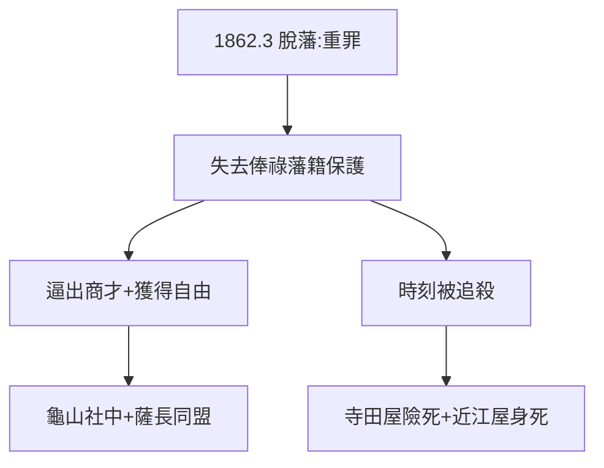

# 2.3 脫藩（1862）

## 1862 年 3 月：離開土佐

龍馬未經許可離開土佐藩（脫藩），成為浪人。脫藩在當時是重罪（理論上可處死），土佐藩後來確實下達通緝。但他別無選擇：藩的攘夷路線與他的開國信念（2.2）水火不容，藩的等級（1.1）也容不下他的野心。

## 脫藩者的自由

- 失去俸祿，自謀生路——逼出商才（3.1 的龜山社中）；
- 失去藩籍，獲得日本——可以自由聯合薩摩、長州（3.2）；
- 失去保護，時刻被追殺——寺田屋（3.3）、近江屋（5.1）兩次險死還生，一次身死。

## 脫藩的時代意義

1860 年代，大批下級武士脫藩，成為「志士」階層——脫離藩體制的人，反而成了推翻體制的人。龍馬是其中最著名的一個，因為他走得最遠：從脫藩到脫「日本」（構想世界）。

**因果**：身份的不甘（1.1）+ 開國的信念（2.2）= 脫藩。失去一切，得到一切——脫藩是龍馬的成人禮。下一章，自由人的十年：商社、同盟、遇刺。
