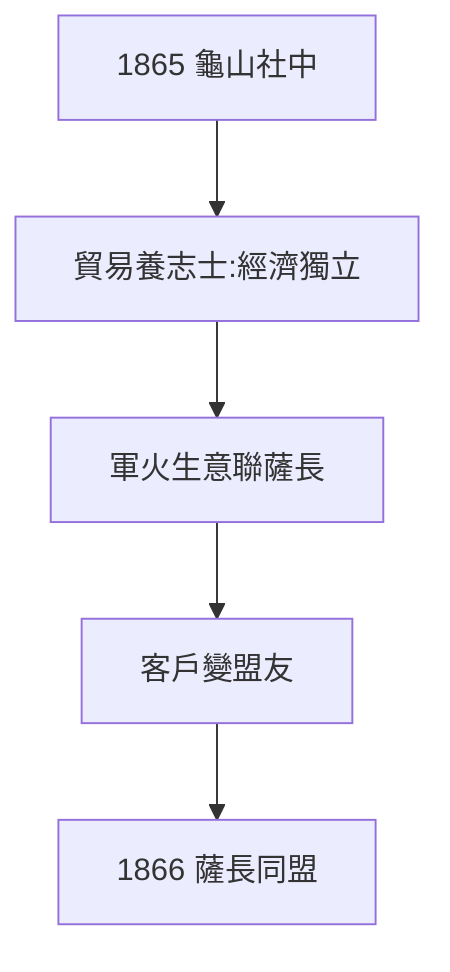

# 3.1 龜山社中（1865）

## 1865：日本第一家公司？

龍馬在長崎龜山創辦「龜山社中」：名為政治結社，實為貿易公司——販軍火、跑運輸、 آموزش航海。後改組為「海援隊」，被視為日本第一家近代企業（三菱的岩崎彌太郎曾在此工作過，後來自立門戶）。

## 商人的革命

- 用商業養志士：不靠藩的俸祿，靠市場的利潤——經濟獨立才能政治獨立；
- 用商業聯薩長：為長州運軍火、為薩摩跑船，順手把死敵變成客戶，客戶變成盟友（見 3.2）；
- 劍（1.2）+ 商（1.1 家學）+ 船（2.2 海軍）的三合一。

## 時代的超前

武士經商在當時是恥辱，龍馬卻說「金比刀有用」。他的超前在於：**看出軍事、商業、政治是一體的**——薩長同盟的本質，就是一筆軍火生意談成的政治。

**因果**：脫藩逼出的商才（2.3）+ 阪本家學 + 勝海舟的海軍思想 = 龜山社中。公司是手段，同盟是目的——下一節，日本近代史上最著名的斡旋。
