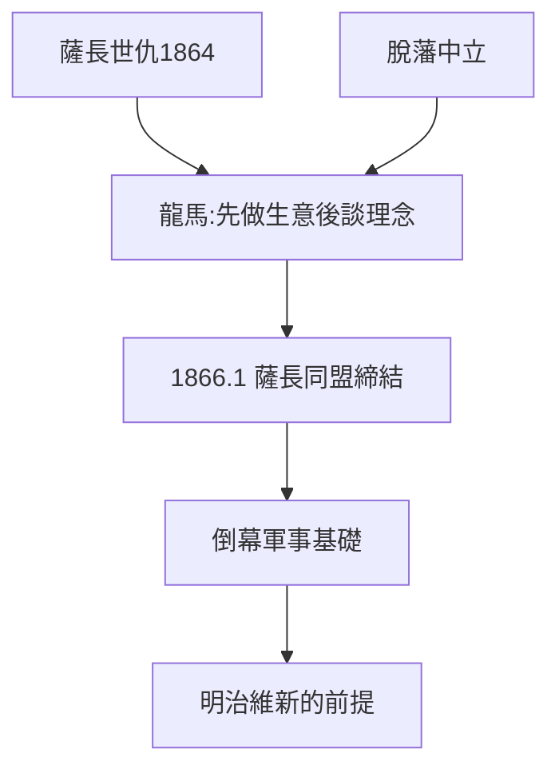

# 3.2 薩長同盟斡旋（1866）

## 死敵的握手

薩摩與長州是世仇（禁門之變 1864，薩摩助幕府打長州）。1866 年 1 月，龍馬斡旋，西鄉隆盛（薩）與桂小五郎（木戶孝允，長）在京都締結**薩長同盟**：倒幕的軍事同盟。沒有這個同盟，就沒有戊辰戰爭的勝利，就沒有明治維新。

## 斡旋的技術

- 先做生意：薩摩的米換長州的軍火（經龜山社中之手，3.1），利益先行；
- 再談理念：共同的敵人（幕府）大於彼此的仇恨；
- 人格擔保：龍馬以性命擔保雙方履約——中間人的信用就是契約。

## 龍馬的位置

他不是薩摩人，不是長州人，不是幕府人——**正因為一無所有（脫藩，2.3），才能調和所有**。中立是他的權力來源，也是他一生危險的來源（見 5.1）。

**因果**：龜山社中的生意（3.1）鋪路，脫藩的中立（2.3）背書，遊學的人脈（2.1）牽線——十年積累，在 1866 年 1 月兌現。這是龍馬一生最高的山峰。下一節，山峰上的遇刺。
