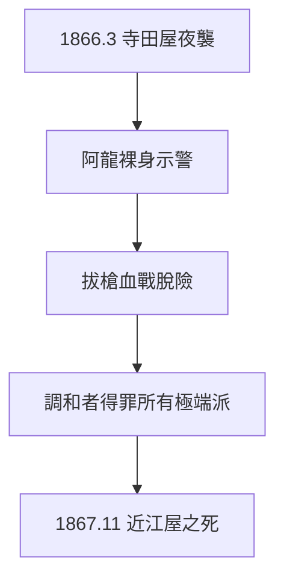

# 3.3 寺田屋事件（1866）

## 1866 年 3 月 8 日深夜

薩長同盟締結兩個月後，幕府捕快夜襲龍馬下榻的京都寺田屋旅館。妻子阿龍（楢崎龍，1864 年相識）機警，泡澡時聽到異響，裸身示警。龍馬拔槍（美國左輪，勝海舟所贈）還擊，手部重傷，與同伴三吉慎藏殺出重圍，投靠薩摩藩邸避難。

## 阿龍：被遺忘的功臣

- 冒死示警，救龍馬一命；
- 婚後陪伴顛沛流離，龍馬死後（5.1）改嫁，晚年貧困；
- 2010 年代 NHK 大河劇《龍馬傳》讓她重回公眾視野——歷史記住英雄，常忘記救英雄的人。

## 事件的意義

寺田屋證明：龍馬的路是拿命換的。同盟（3.2）剛締結，暗殺就到——**調和者得罪所有極端派**：幕府視他為叛徒，攘夷派視他為賣國。這條規律在 1867 年 11 月兌現為死亡（5.1）。

**因果**：薩長同盟（3.2）的成功，招來殺身之禍。寺田屋是預演，近江屋是正片——中間隔著他一生最後的政治遺產：船中八策（第 4 章）。
