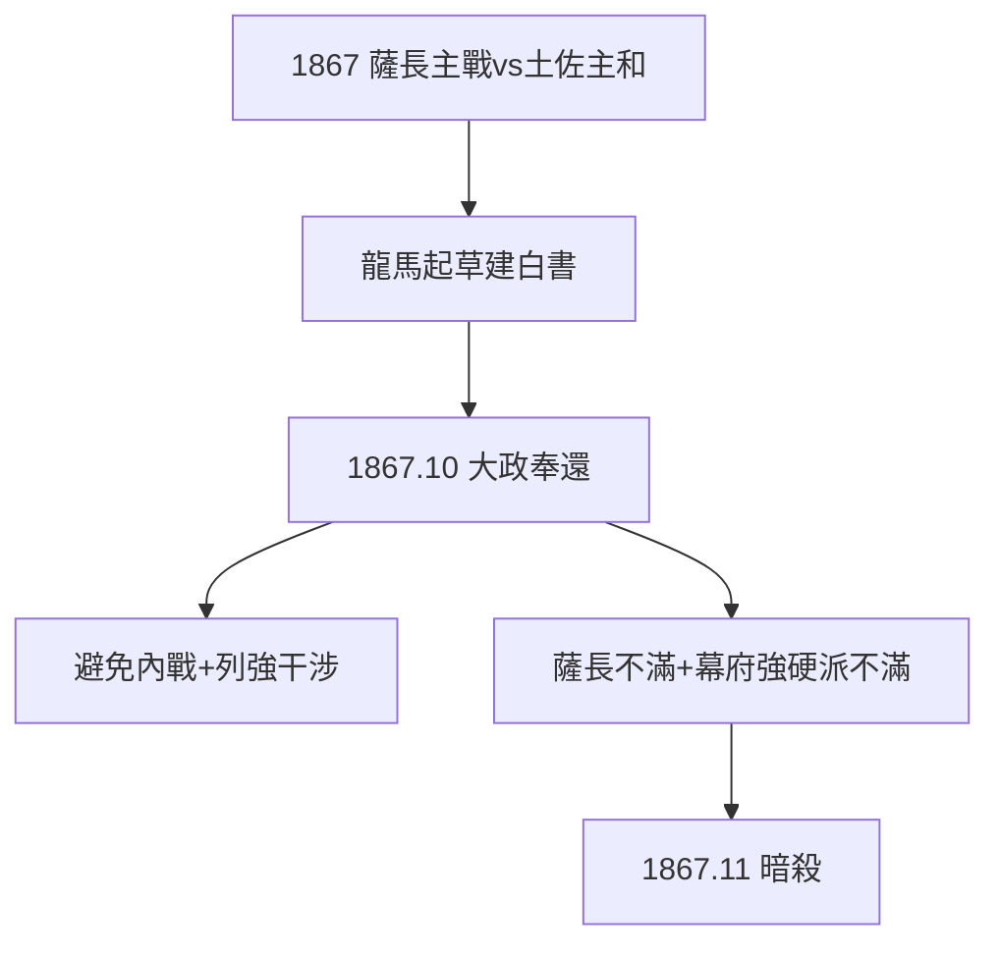

# 4.1 大政奉還構想（1867）

## 1867 年：和平倒幕 vs 武力倒幕

薩長主張武力倒幕（王政復古），土佐的後藤象二郎主張和平：由龍馬起草建白書，勸將軍德川慶喜**大政奉還**——把政權還給天皇，避免內戰。1867 年 10 月，慶喜接受，大政奉還實現。

## 龍馬的算計

- 避免內戰：內戰會給列強干涉的口實（黑船的教訓，1.3）；
- 給幕府留體面：和平過渡，全國團結對外；
- 給土佐留位置：後藤象二郎的新政府中有席位——為故鄉（也是為自己）爭取未來。

## 悲劇的伏筆

大政奉還太成功，反而激怒薩長（到手的武力勝利被和平摘桃），也激怒幕府強硬派——**調和者再次得罪所有人**（3.3 的規律重演）。一個月後，近江屋的刀落了下來。

**因果**：黑船的教訓（1.3：勿給列強口實）+ 調和者的本能（3.2）= 大政奉還。這是他政治生涯的頂峰，也是死亡通知書。下一節，頂峰的文字：船中八策。
