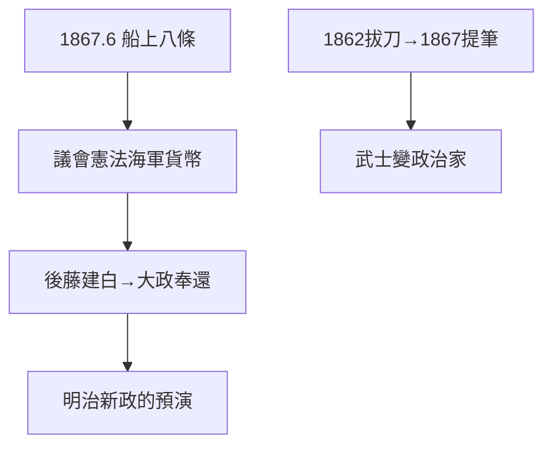

# 4.2 船中八策（1867）

## 1867 年 6 月：船上的八條

龍馬在從長崎赴京的船上寫下《船中八策》：大政奉還、設上下議政局、舉人才、開國和親、制定憲法、海軍擴張、御親兵、貨幣統一——新日本的藍圖。後藤象二郎以此為基礎提出建白，推動大政奉還（4.1）。

## 八策的超前

- 議會、憲法、海軍、貨幣——明治政府後來做的，他提前寫了；
- 「上下議政局」：連議會兩院制都想到了；
- 有學者質疑文本真偽（原件已佚，後藤回憶整理），但思想歸屬無爭議。

## 從劍到筆

1862 年拔刀闖勝宅（2.2），1867 年提筆寫國策——五年，從武士變成政治家。劍術（1.2）早已放下，筆成了他最後的武器。

**因果**：遊學的思考（2.1）+ 開國的信念（2.2）+ 商社的實務（3.1），濃縮為八條。船中八策是龍馬留給日本的遺囑——寫完五個月後，他死了（第 5 章）。
