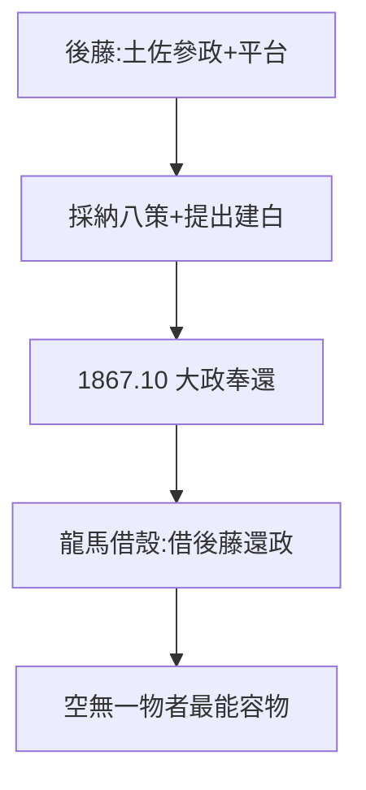

# 4.3 後藤象二郎（1867）

## 伯樂與平台

後藤象二郎（土佐藩參政）是龍馬最重要的政治盟友：接納脫藩的龍馬、採納船中八策（4.2）、以土佐名義提出大政奉還建白（4.1）。沒有後藤，龍馬的構想只是浪人的空談；沒有龍馬，後藤的建白只是官僚的公文。

## 土佐的驕傲與尷尬

- 驕傲：大政奉還是土佐主導的，龍馬是土佐人；
- 尷尬：龍馬是脫藩者，土佐曾通緝他——英雄與故鄉的關係，愛恨交織；
- 明治後，後藤成為伯爵，龍馬追贈正四位——官方承認遲到了二十年。

## 同盟的藝術

龍馬一生都在「借殼」：借勝海舟的殼學海軍（2.2），借薩長的殼倒幕（3.2），借後藤的殼還政（本節）。脫藩者（2.3）一無所有，所以能借一切——**空無一物者，最能容物**。

**因果**：船中八策（4.2）需要後藤的殼，大政奉還（4.1）需要土佐的名。龍馬的「借殼藝術」在 1867 年 10 月登峰造極。一個月後，殼還在，人沒了（第 5 章）。
