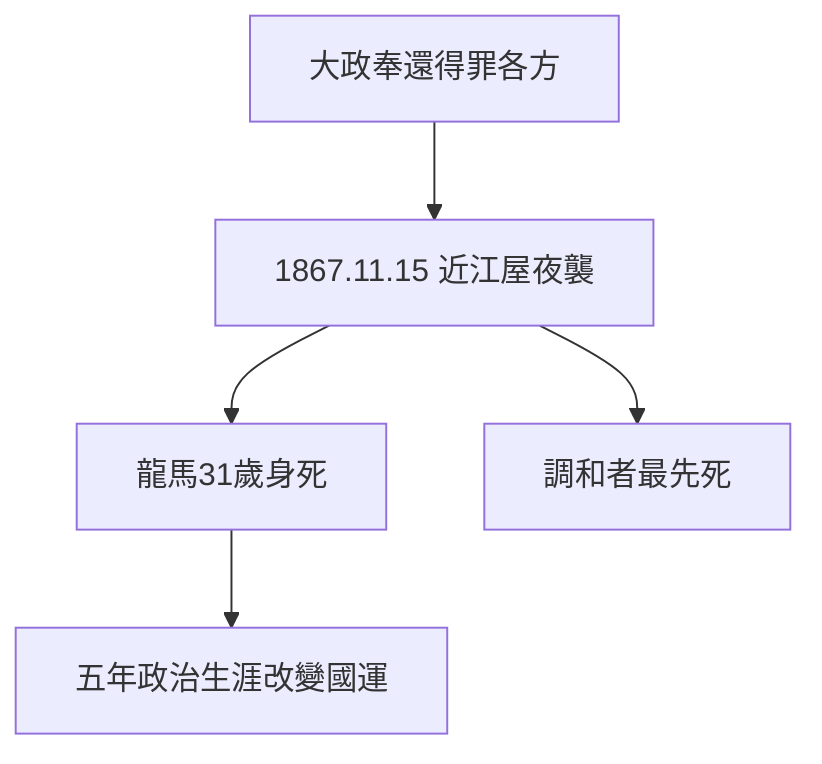

# 5.1 近江屋事件（1867）

## 1867 年 11 月 15 日：京都近江屋

龍馬與同伴中岡慎太郎在醬油商近江屋二樓養傷（寺田屋舊傷未癒），刺客夜入，亂刀砍殺。龍馬當場死亡，年僅 31 歲；中岡重傷，兩天後死去。阿龍當時不在京都——夫妻最後一面，竟成永別。

## 31 年的密度

- 1836 出生 → 1853 黑船 → 1862 脫藩 → 1865 商社 → 1866 同盟 → 1867 八策 → 1867 身死；
- 實際政治生涯不足五年，改變日本國運；
- 死前一晚還在與陸援隊隊員談笑，毫無預感。

## 調和者的宿命

大政奉還（4.1）得罪了所有極端派（3.3 的規律）：薩摩不滿、幕府不滿、攘夷派不滿。刺客來自哪一方不重要（見 5.2）——重要的是，**在撕裂的時代，調和者最先死**。

**因果**：從脫藩（2.3）到身死，不過五年。寺田屋（3.3）是預演，近江屋是結局——調和者的宿命。下一節，兇手之謎。
