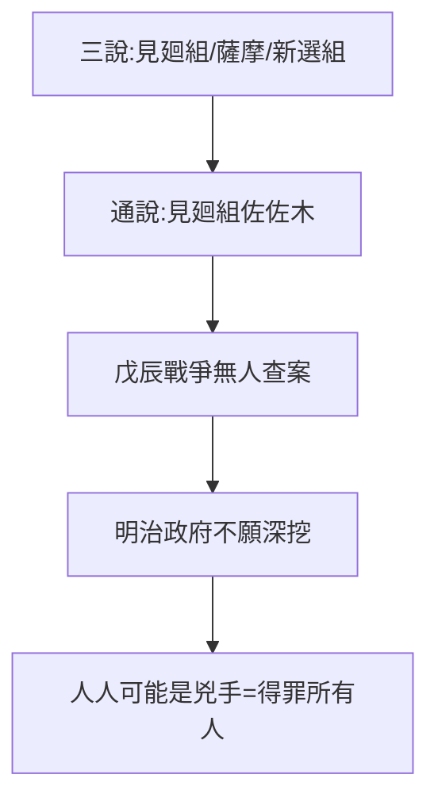

# 5.2 兇手之謎（1867–1870）

## 三種說法

1. **幕府京都見廻組**：佐佐木只三郎率隊，1870 年今井信郎供述參與——通說；
2. **薩摩藩暗殺**：不滿大政奉還摘桃，田中光顯晚年暗示；
3. **土佐/新選組**：各種陰謀論，證據薄弱。

## 為什麼查不清

- 戊辰戰爭爆發（1868），各方忙著打仗，無人認真查案；
- 明治政府需要團結，不願深挖（無論兇手是誰，都是「自己人」）；
- 史料多為幾十年後的回憶，可信度遞減。

## 謎的意義

兇手是誰不重要，重要的是**人人都可能是兇手**——這正是調和者之死的本質：得罪所有人，就等於被所有人殺。5.1 的結論在此得到註腳。

**因果**：查不清本身就是答案——撕裂時代的調和者，死於「所有人」。下一節，死亡如何變成神話。
